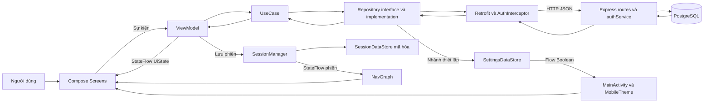
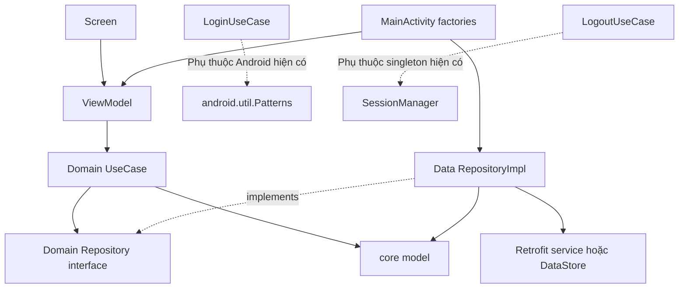
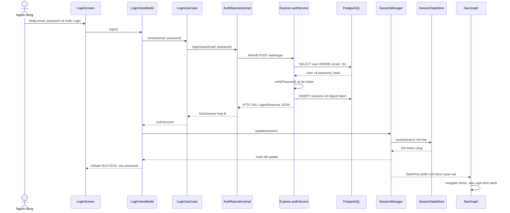
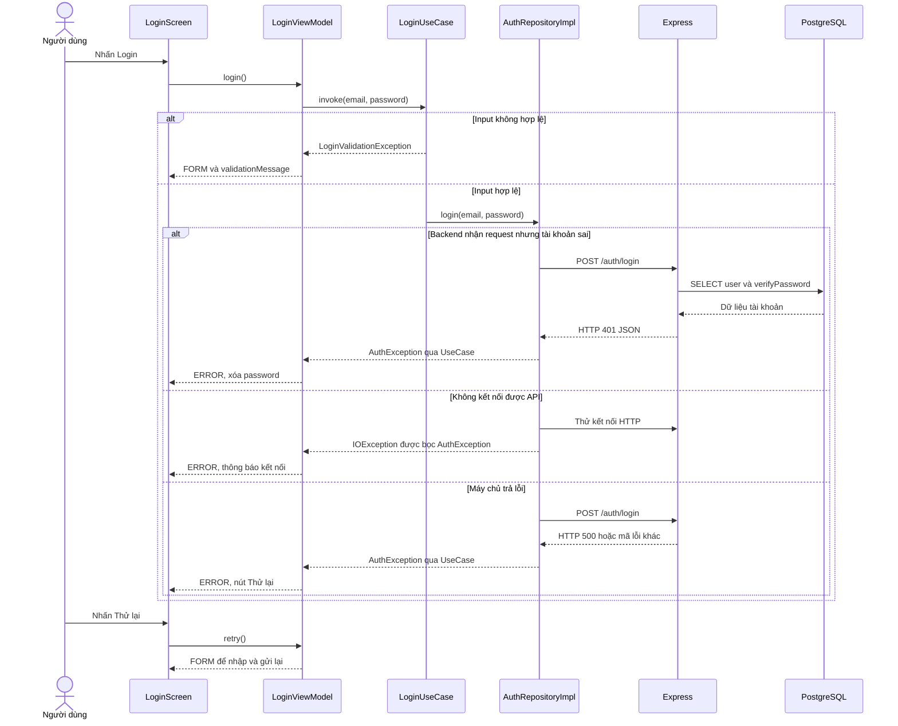
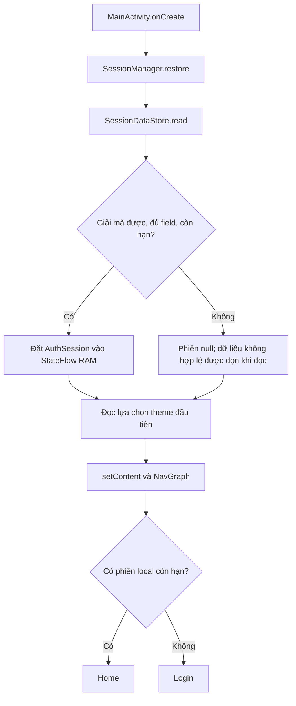
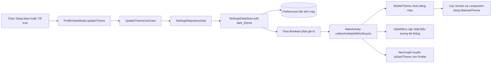
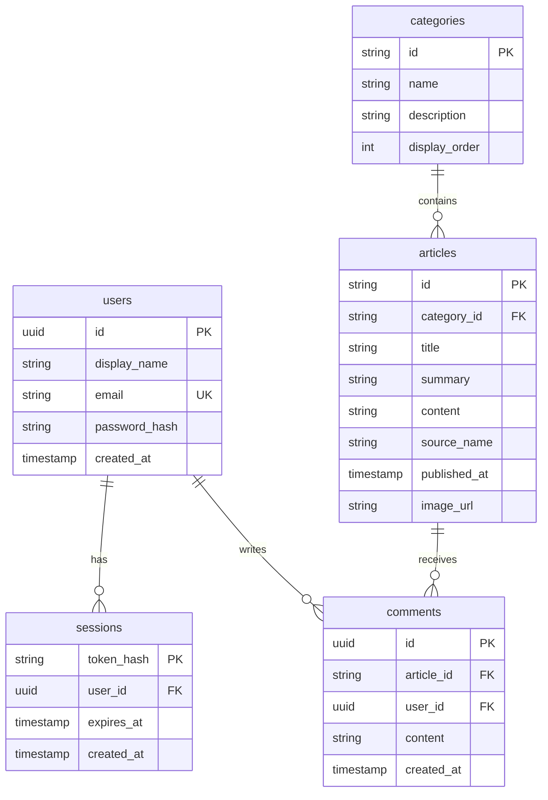

# NewsHub — Đọc hiểu project và chuẩn bị vấn đáp

Phân tích ngày **27/10/2026**, project **D:\GreetingCard**, package thực tế **com.example.mobile**.

Tài liệu dựa trên mã nguồn được đọc ở thời điểm phân tích. “Đã triển khai” ở đây nghĩa là có code và được nối vào luồng chạy; không đồng nghĩa với đã chạy lại mọi trường hợp trên máy ở lượt này. Không có lệnh build, test, migration, seed, gọi API ghi dữ liệu hoặc chỉnh cấu hình được thực hiện trong lượt phân tích. Báo cáo và bản kiểm kê được lưu riêng tại `D:\BTL\newshub-review`, ngoài project.

Không đọc các file `.env`, mật khẩu PostgreSQL, dữ liệu tài khoản hay token thật. Ví dụ JSON phía dưới chỉ mô tả cấu trúc, không chứa thông tin đăng nhập thật.

## 1. Những điều cần nắm trước khi học từng file

Ứng dụng có hai chương trình chạy độc lập: **Android** dựng giao diện và gọi HTTP; **backend Node.js/Express** xác thực, xử lý yêu cầu và truy vấn **PostgreSQL**. Android không mở kết nối PostgreSQL trực tiếp. Docker là một cách đóng gói/chạy backend; project cũng có cách chạy native trên Windows. Xem [MainActivity.kt](D:/GreetingCard/app/src/main/java/com/example/mobile/MainActivity.kt:46), [core/network/RetrofitClient.kt](D:/GreetingCard/app/src/main/java/com/example/mobile/core/network/RetrofitClient.kt:9), [backend/src/server.mjs](D:/GreetingCard/backend/src/server.mjs:1) và [docker-compose.yml](D:/GreetingCard/docker-compose.yml:1).

Đã kiểm kê **82 file Kotlin** trong `app/src/main/java/com/example/mobile/`; **20 file trống**, tức 62 file có nội dung. Phần mềm thực tế chưa có đủ mọi chức năng chỉ vì cây thư mục đã có tên file.

### 1.1. Trạng thái chức năng theo source

| Phần | Trạng thái | Căn cứ và giới hạn |
|---|---|---|
| Login thật | Đã triển khai | `LoginScreen → LoginViewModel → LoginUseCase → AuthRepositoryImpl → AuthApiService`, factory dùng repository thật; backend xác thực PostgreSQL. |
| Lưu/khôi phục phiên | Đã triển khai | `SessionManager` và `SessionDataStore`; phiên mã hóa, có kiểm tra hạn lúc đọc. |
| Home, danh mục | Đã triển khai | API `/categories`, `/articles`; lọc danh mục phía server; có loading/data/empty/error/retry. |
| Search | Đã triển khai | Từ khóa + danh mục, debounce 300 ms, hủy tác vụ tìm kiếm cũ. |
| Đọc nội dung bài | Đã triển khai | Truyền ID, API `/articles/{id}`, nội dung đầy đủ, xử lý 404 và thử lại. |
| Profile cơ bản | Đã triển khai | Hiện tên/email lấy từ User trong phiên local; chưa gọi `/auth/me` để làm mới hồ sơ. |
| Logout | Đã triển khai | Gọi backend hủy token, xóa phiên máy, navigation về Login và bỏ stack được bảo vệ. Lỗi mạng giữ phiên để thử lại. |
| Theme Sáng/Tối | Đã triển khai | Hai `FilterChip`, Preferences DataStore, áp dụng từ `MainActivity`, đồng bộ biểu tượng hệ thống. |
| Theme System/Hệ thống | Chưa triển khai trong luồng app | `MobileTheme` có giá trị mặc định theo hệ thống, nhưng `MainActivity` luôn truyền Boolean đã lưu; không có nút System hay giá trị thứ ba. |
| Register phía Android | Chưa triển khai | Ba file Register trống; chữ Đăng ký ở Login chưa có thao tác chuyển màn. Backend đã có API register. |
| Comments phía Android | Chưa triển khai | Có model `Comment`; `PostCommentUseCase.kt` trống; không có UI/API service bình luận trong app. Backend GET/POST bình luận đã có. |
| Saved/Room/offline bài viết | Chưa triển khai | Toàn bộ file Saved/DAO/Database trống; Gradle chưa khai báo Room; tab Saved đang bị vô hiệu hóa. |
| Toàn module Auth và Article | Đang triển khai một phần | Login/đọc bài đã có; Register/bình luận chưa được tích hợp. “Đang” mô tả mức hoàn thiện, không khẳng định ai đang sửa code. |
| Docker runtime | Có cấu hình, chưa xác minh chạy ở lượt này | Có Dockerfile/Compose. `docs/testing-guide.md` ghi trước đó mới kiểm tra cấu hình, chưa chạy engine/container. |

Căn cứ chính: [navigation/NavGraph.kt](D:/GreetingCard/app/src/main/java/com/example/mobile/navigation/NavGraph.kt:43), [core/ui/components/NewsHubBottomBar.kt](D:/GreetingCard/app/src/main/java/com/example/mobile/core/ui/components/NewsHubBottomBar.kt:15), [app/build.gradle.kts](D:/GreetingCard/app/build.gradle.kts:1), [feature/auth/data/AuthApiService.kt](D:/GreetingCard/app/src/main/java/com/example/mobile/feature/auth/data/AuthApiService.kt:9), [feature/profile/presentation/ProfileScreen.kt](D:/GreetingCard/app/src/main/java/com/example/mobile/feature/profile/presentation/ProfileScreen.kt:15), [docs/testing-guide.md](D:/GreetingCard/docs/testing-guide.md:1).

### 1.2. Đối chiếu tài liệu của thầy

Đã đọc được **INSTRUCTION.md v1.2.2 (2026-10-13)** trên repo chính thức. File đó không có ở thư mục gốc project hiện tại. Các đối chiếu dưới đây là nhận xét từ source, không phải điểm chấm hay xác nhận đã đáp ứng toàn bộ môn học. [Yêu cầu chính thức](https://github.com/hungdn1701/mobile-app-starter/blob/main/INSTRUCTION.md).

| Mục của thầy | Đối chiếu với source NewsHub |
|---|---|
| [§4.2](https://github.com/hungdn1701/mobile-app-starter/blob/main/INSTRUCTION.md#4-mandatory-technical-requirements) — màn hình chức năng | Có Login, Home, Search, Detail, Profile được nối; không tính Register/Saved trống. |
| §4.3 — “Layered architecture” | Screen nhận state/callback; các luồng nghiệp vụ qua ViewModel, UseCase, Repository. |
| §4.4 — trạng thái UI | Home/Search có bốn nhánh; Detail có loading/error/data/fallback; Login là form/loading/result. |
| §4.5 — REST | Có đọc bài/danh mục và ghi yêu cầu login/logout qua HTTP. |
| §4.6 — “Local persistence” | Phiên được mã hóa, theme lưu local; bài báo offline chưa có. |
| §4.7 — “No hard-coded configuration” | URL tập trung một chỗ nhưng vẫn là literal trong `ApiConfig`, chưa lấy từ cấu hình build. |
| [§6 C1–C3](https://github.com/hungdn1701/mobile-app-starter/blob/main/INSTRUCTION.md#c-individual-oral-defense--40-individual), [§7–§8](https://github.com/hungdn1701/mobile-app-starter/blob/main/INSTRUCTION.md#7-ai-usage-policy) | Cần giải thích code, quyết định và bằng chứng đóng góp/AI; báo cáo này không thay xác nhận của thành viên. |

## 2. Kiến trúc đang dùng

### 2.1. MVVM trong chính NewsHub

**MVVM** là Model–View–ViewModel: Model biểu diễn dữ liệu; View là giao diện; ViewModel giữ trạng thái và xử lý thao tác giao diện. NewsHub bổ sung Domain/UseCase và Repository, tạo thành kiến trúc phân lớp trong cùng module Android.

Ví dụ Login: `User`, `AuthSession` là model; `LoginScreen` là View; `LoginViewModel` giữ `AuthUiState`. UI nhận một `uiState`, vẽ theo state, rồi phát sự kiện như `onEmailChanged`, `onLoginClick`. `NavGraph` nối callback với hàm của ViewModel. Screen không gọi Retrofit hoặc SQL. Xem [feature/auth/presentation/LoginScreen.kt](D:/GreetingCard/app/src/main/java/com/example/mobile/feature/auth/presentation/LoginScreen.kt:57), [feature/auth/presentation/LoginViewModel.kt](D:/GreetingCard/app/src/main/java/com/example/mobile/feature/auth/presentation/LoginViewModel.kt:16), [navigation/NavGraph.kt](D:/GreetingCard/app/src/main/java/com/example/mobile/navigation/NavGraph.kt:43).



Mũi tên trên mô tả luồng gọi/trả dữ liệu. Riêng nhánh settings đi qua `SettingsRepositoryImpl`; nhánh network đi qua các repository tương ứng. Không có đường Room hoạt động để vẽ thêm vào kiến trúc đã triển khai.

### 2.2. Vì sao tách `core/`, `feature/`, `navigation/`?

| Thư mục | Trách nhiệm thực tế | Ví dụ kết nối |
|---|---|---|
| `core/model` | Dữ liệu dùng ở nhiều feature | `Article` dùng ở Home, Search, Detail; `User` dùng Login và Profile. |
| `core/network` | Tạo HTTP client và gắn token | Retrofit dùng `ApiConfig`, OkHttp gọi `AuthInterceptor`. |
| `core/datastore`, `core/session` | Lưu bền thiết lập/phiên và cung cấp phiên trong RAM | Login ghi; interceptor đọc token; navigation quan sát phiên. |
| `core/ui/components` | Composable có thể dùng lại | Header/bottom bar ở NavGraph; ArticleCard ở Home/Search; ErrorState ở ba màn. |
| `feature/<tên>` | Gom code theo chức năng | Home gồm presentation/domain/data; người học theo được một luồng hoàn chỉnh. |
| `navigation` | Định danh route và điều phối màn hình | Routes tạo đường dẫn Detail; NavGraph sở hữu NavHost và kiểm tra phiên. |
| `ui/theme` | Theme hiện được dùng | MainActivity import `com.example.mobile.ui.theme.MobileTheme`. |

`core/ui/theme` cũng tồn tại nhưng cả ba file ở đó trống. Do đó, không được nhầm hai đường dẫn theme. Project chỉ có một module Gradle `:app`; các thư mục không phải các module được compiler cưỡng chế tách biệt. [settings.gradle.kts](D:/GreetingCard/settings.gradle.kts:1), [ui/theme/Theme.kt](D:/GreetingCard/app/src/main/java/com/example/mobile/ui/theme/Theme.kt:1).

### 2.3. Ba layer và chiều phụ thuộc

| Layer | Làm gì trong app | Không nên nhầm với |
|---|---|---|
| Presentation | Screen dựng UI; ViewModel quản lý `UiState`, tác vụ và lỗi cho người dùng | ViewModel không phải nơi viết SQL; Screen không phải repository. |
| Domain | Interface repository và các hành động UseCase | Không phải mọi UseCase đều có nghiệp vụ phức tạp; nhiều hàm hiện chỉ chuyển tiếp. |
| Data | Retrofit service, DTO, repository implementation, DataStore | Có tên Entity không có nghĩa Room đã tồn tại. |



Điểm quan trọng: `LoginViewModel` biết `LoginUseCase`; UseCase biết `AuthRepository` interface; `AuthRepositoryImpl` triển khai interface đó và biết `AuthApiService`. Hướng phụ thuộc compile của implementation tới interface khác với hướng dữ liệu chạy từ UseCase tới implementation đã được factory đưa vào.

Đây là MVVM phân lớp có một số ý tưởng Clean Architecture, **chưa phải domain hoàn toàn độc lập framework**: LoginUseCase import `android.util.Patterns`; LogoutUseCase import singleton SessionManager. Đây là giới hạn có thật, không phải vi phạm tự động mọi yêu cầu MVVM. [feature/auth/domain/LoginUseCase.kt](D:/GreetingCard/app/src/main/java/com/example/mobile/feature/auth/domain/LoginUseCase.kt:8), [feature/auth/domain/LogoutUseCase.kt](D:/GreetingCard/app/src/main/java/com/example/mobile/feature/auth/domain/LogoutUseCase.kt:6).

### 2.4. Model, DTO, Entity

| Loại | Ví dụ thật | Ý nghĩa và giới hạn |
|---|---|---|
| Model | `User`, `Article`, `Category`, `Comment`, `AuthSession` | Các cấu trúc dữ liệu app dùng. `User` không có password/token; `AuthSession` có token, hạn và User. |
| DTO — Data Transfer Object, đối tượng trao đổi dữ liệu | `LoginRequest`, `LoginResponse` | Định dạng JSON gửi/nhận HTTP. Response được kiểm tra rồi chuyển thành AuthSession. |
| Entity — đối tượng biểu diễn bản ghi lưu trữ | `SavedArticleEntity.kt` | File hiện trống; chưa có class, `@Entity`, bảng Room hoặc mapper. Không có Entity Room đã hoạt động để phân tích. |

Các loại có thể giống cấu trúc mà khác vai trò. `LoginResponse` và `AuthSession` hiện cùng ba trường; repository tạo AuthSession sau khi kiểm tra response. `Article` hiện được dùng trực tiếp làm kiểu Retrofit trả về, nên đang kiêm cả vai trò model và DTO. Chưa có `ArticleDto` riêng. [core/model/Article.kt](D:/GreetingCard/app/src/main/java/com/example/mobile/core/model/Article.kt:3), [feature/auth/data/dto/LoginResponse.kt](D:/GreetingCard/app/src/main/java/com/example/mobile/feature/auth/data/dto/LoginResponse.kt:5), [feature/auth/data/AuthRepositoryImpl.kt](D:/GreetingCard/app/src/main/java/com/example/mobile/feature/auth/data/AuthRepositoryImpl.kt:13).

### 2.5. Repository interface, implementation và UseCase

`AuthRepository` giống một hợp đồng: cần có `login(email,password): AuthSession` và `logout()`. Hợp đồng không biết địa chỉ API. `AuthRepositoryImpl` thực hiện bằng Retrofit, kiểm tra response và chuyển lỗi. `FakeAuthRepository` là một implementation khác để demo; factory hiện không chọn nó. [feature/auth/domain/AuthRepository.kt](D:/GreetingCard/app/src/main/java/com/example/mobile/feature/auth/domain/AuthRepository.kt:5), [feature/auth/data/AuthRepositoryImpl.kt](D:/GreetingCard/app/src/main/java/com/example/mobile/feature/auth/data/AuthRepositoryImpl.kt:13), [feature/auth/data/FakeAuthRepository.kt](D:/GreetingCard/app/src/main/java/com/example/mobile/feature/auth/data/FakeAuthRepository.kt:9).

UseCase biểu diễn một hành động của ứng dụng. `LoginUseCase` kiểm tra email/mật khẩu; `SearchArticlesUseCase` trim và giới hạn từ khóa; `LogoutUseCase` phối hợp hủy phiên server rồi xóa phiên máy. `GetNewsUseCase` và `GetCategoriesUseCase` hiện chủ yếu chuyển tiếp tới repository. Tách UseCase giúp ViewModel tập trung vào state UI, thuận tiện thay logic và kiểm tra độc lập; đổi lại có thêm file và lớp trung gian.

**MVVM không bắt buộc mọi ViewModel phải đi qua UseCase.** Gọi repository trực tiếp từ ViewModel vẫn có thể là MVVM. Project này đã chọn dùng UseCase nhất quán; không nên nói với thầy rằng dùng UseCase là điều kiện duy nhất để có kiến trúc đúng.

### 2.6. StateFlow, Coroutine và UiState qua ví dụ Login

| Thành phần | Hiểu qua code thực tế |
|---|---|
| `AuthUiState` | Một bản chụp dữ liệu màn Login: email, password trong RAM, status và thông báo. Nó không tự gọi API. |
| `MutableStateFlow` | `_uiState` do ViewModel sở hữu; `.update { it.copy(...) }` tạo state mới. |
| `StateFlow` | `uiState = _uiState.asStateFlow()` cho UI quan sát mà không được gán trực tiếp `.value`. |
| `collectAsStateWithLifecycle` | NavGraph chuyển Flow thành Compose State khi lifecycle cho phép; Screen được vẽ lại theo dữ liệu mới. |
| Coroutine | Công việc có thể tạm dừng khi chờ network/storage để không chặn luồng UI. `viewModelScope.launch` bắt đầu công việc. |
| `suspend` | Hàm có khả năng tạm dừng; không tự tạo coroutine và không tự đảm bảo chạy nền. |
| `viewModelScope` | Scope gắn với ViewModel; khi ViewModel được hủy thì tác vụ trong scope được hủy. |
| `CancellationException` | Tín hiệu hủy công việc; các ViewModel/repository bắt riêng và ném tiếp, tránh biến thao tác hủy thành lỗi mạng. |
| `Job` | Home/Search giữ tham chiếu tác vụ để hủy lượt cũ trước khi tải lượt mới. |
| `Mutex` | SessionManager khóa các thao tác restore/update/clear để tránh ghi/xóa phiên chồng nhau. |

Trong Login, `launch` thường bắt đầu trên Main; Retrofit suspend thực hiện I/O qua HTTP client, còn `SessionDataStore.save/read` chủ động dùng `withContext(Dispatchers.IO)`. Vì thế không được nói “mọi suspend tự chạy trên luồng nền”. [Giải thích coroutine của Kotlin](https://kotlinlang.org/docs/coroutines-basics.html), [feature/auth/presentation/LoginViewModel.kt](D:/GreetingCard/app/src/main/java/com/example/mobile/feature/auth/presentation/LoginViewModel.kt:16), [core/datastore/SessionDataStore.kt](D:/GreetingCard/app/src/main/java/com/example/mobile/core/datastore/SessionDataStore.kt:28).

`copy` giữ những trường không đổi. `isLoading` trong AuthUiState là thuộc tính tính từ `status`, không phải một giá trị lưu thêm trong DataStore. `StateFlow` giữ state hiện tại trong RAM; dữ liệu chỉ bền qua việc ghi DataStore. ViewModel có thể được giữ khi xoay màn hình, nhưng không sống qua lúc tiến trình bị hệ điều hành hủy. App chưa dùng SavedStateHandle để lưu lại từ khóa/form qua lần mất tiến trình.

### 2.7. Dependency Injection và Factory

**Dependency Injection — truyền phụ thuộc** nghĩa là đưa đối tượng cần dùng vào constructor. Ví dụ `LoginViewModel(loginUseCase)` không tự tạo Retrofit trong chính ViewModel.

Project làm điều này thủ công tại `MainActivity`: `viewModelFactory { initializer { ... } }` tạo chuỗi ApiService → RepositoryImpl → UseCase → ViewModel. `NavGraph` gọi `viewModel(factory=...)` trong từng destination, nên ViewModel gắn với back-stack entry tương ứng. `articleDetailViewModelFactory(articleId)` đưa ID của entry vào DetailViewModel. Không thấy Hilt, Dagger hoặc Koin trong source/dependency. [MainActivity.kt](D:/GreetingCard/app/src/main/java/com/example/mobile/MainActivity.kt:46), [navigation/NavGraph.kt](D:/GreetingCard/app/src/main/java/com/example/mobile/navigation/NavGraph.kt:43), [app/build.gradle.kts](D:/GreetingCard/app/build.gradle.kts:1).

### 2.8. Network hiện tại và timeout vừa được đối chiếu lại

`RetrofitClient` tạo singleton lazy cho OkHttp và Retrofit; Gson converter nối DTO/model với JSON. Trong lúc phân tích, file này được thay đổi bên ngoài thao tác của báo cáo; bản đọc lại mới nhất có `connectTimeout(15, SECONDS)`, `readTimeout(30, SECONDS)`, `writeTimeout(15, SECONDS)`. Vì vậy không còn đúng nếu nói app chưa cấu hình timeout riêng. Connect giới hạn thời gian thiết lập kết nối; read/write giới hạn thao tác đọc/ghi tương ứng, không phải một cam kết tổng request hoàn thành trong30 giây. Không thấy cấu hình callTimeout riêng cho toàn lời gọi. [core/network/RetrofitClient.kt](D:/GreetingCard/app/src/main/java/com/example/mobile/core/network/RetrofitClient.kt:9).

`AuthInterceptor.intercept(chain)` đọc token từ RAM mỗi request rồi thêm Authorization; sau đó gọi chain.proceed. Nó không đọc DataStore mỗi lần và không xử lý response401. Base URL vẫn lấy từ literal trong ApiConfig. Ba timeout vừa có không tự tạo retry UI, refresh token hoặc offline cache. Phần báo cáo này phản ánh code đọc lại, không phải code do lượt phân tích thêm vào.

## 3. Cây thư mục và bản đồ file

Đường dẫn Kotlin gốc: `D:\GreetingCard\app\src\main\java\com\example\mobile`. Tên file có liên kết để mở source thật. Các file trống vẫn được ghi rõ; không có class/hàm được suy diễn từ tên file.

### 3.1. Toàn bộ cây `app/src` và cấu hình module

```text
app/
├── build.gradle.kts
├── proguard-rules.pro
└── src/
    ├── androidTest/
    │   └── java/
    │       └── com/
    │           └── example/
    │               └── mobile/
    │                   └── ExampleInstrumentedTest.kt
    ├── main/
    │   ├── java/
    │   │   └── com/
    │   │       └── example/
    │   │           └── mobile/
    │   │               ├── core/
    │   │               │   ├── database/
    │   │               │   │   ├── dao/
    │   │               │   │   │   └── SavedArticleDao.kt [trống]
    │   │               │   │   └── NewsHubDatabase.kt [trống]
    │   │               │   ├── datastore/
    │   │               │   │   ├── SessionDataStore.kt
    │   │               │   │   └── SettingsDataStore.kt
    │   │               │   ├── mobile/
    │   │               │   ├── model/
    │   │               │   │   ├── Article.kt
    │   │               │   │   ├── AuthSession.kt
    │   │               │   │   ├── Category.kt
    │   │               │   │   ├── Comment.kt
    │   │               │   │   └── User.kt
    │   │               │   ├── network/
    │   │               │   │   ├── ApiConfig.kt
    │   │               │   │   ├── ApiResult.kt [trống]
    │   │               │   │   ├── AuthInterceptor.kt
    │   │               │   │   └── RetrofitClient.kt
    │   │               │   ├── session/
    │   │               │   │   └── SessionManager.kt
    │   │               │   ├── ui/
    │   │               │   │   ├── components/
    │   │               │   │   │   ├── ArticleCard.kt
    │   │               │   │   │   ├── ErrorState.kt
    │   │               │   │   │   ├── LoadingSkeleton.kt
    │   │               │   │   │   ├── NewsHubBottomBar.kt
    │   │               │   │   │   └── NewsHubHeader.kt
    │   │               │   │   └── theme/
    │   │               │   │       ├── Color.kt [trống]
    │   │               │   │       ├── Theme.kt [trống]
    │   │               │   │       └── Type.kt [trống]
    │   │               │   └── util/
    │   │               │       └── Constants.kt [trống]
    │   │               ├── feature/
    │   │               │   ├── article/
    │   │               │   │   ├── data/
    │   │               │   │   │   ├── ArticleApiService.kt
    │   │               │   │   │   └── ArticleRepositoryImpl.kt
    │   │               │   │   ├── domain/
    │   │               │   │   │   ├── ArticleRepository.kt
    │   │               │   │   │   ├── GetArticleDetailUseCase.kt
    │   │               │   │   │   └── PostCommentUseCase.kt [trống]
    │   │               │   │   └── presentation/
    │   │               │   │       ├── ArticleDetailScreen.kt
    │   │               │   │       ├── ArticleDetailUiState.kt
    │   │               │   │       └── ArticleDetailViewModel.kt
    │   │               │   ├── auth/
    │   │               │   │   ├── data/
    │   │               │   │   │   ├── dto/
    │   │               │   │   │   │   ├── LoginRequest.kt
    │   │               │   │   │   │   └── LoginResponse.kt
    │   │               │   │   │   ├── AuthApiService.kt
    │   │               │   │   │   ├── AuthRepositoryImpl.kt
    │   │               │   │   │   └── FakeAuthRepository.kt
    │   │               │   │   ├── domain/
    │   │               │   │   │   ├── AuthException.kt
    │   │               │   │   │   ├── AuthRepository.kt
    │   │               │   │   │   ├── LoginUseCase.kt
    │   │               │   │   │   ├── LogoutUseCase.kt
    │   │               │   │   │   └── RegisterUseCase.kt [trống]
    │   │               │   │   └── presentation/
    │   │               │   │       ├── AuthUiState.kt
    │   │               │   │       ├── LoginScreen.kt
    │   │               │   │       ├── LoginViewModel.kt
    │   │               │   │       ├── RegisterScreen.kt [trống]
    │   │               │   │       └── RegisterViewModel.kt [trống]
    │   │               │   ├── home/
    │   │               │   │   ├── data/
    │   │               │   │   │   ├── HomeRepositoryImpl.kt
    │   │               │   │   │   └── NewsApiService.kt
    │   │               │   │   ├── domain/
    │   │               │   │   │   ├── GetCategoriesUseCase.kt
    │   │               │   │   │   ├── GetNewsUseCase.kt
    │   │               │   │   │   └── HomeRepository.kt
    │   │               │   │   └── presentation/
    │   │               │   │       ├── HomeScreen.kt
    │   │               │   │       ├── HomeUiState.kt
    │   │               │   │       └── HomeViewModel.kt
    │   │               │   ├── profile/
    │   │               │   │   ├── data/
    │   │               │   │   │   └── SettingsRepositoryImpl.kt
    │   │               │   │   ├── domain/
    │   │               │   │   │   ├── SettingsRepository.kt
    │   │               │   │   │   └── UpdateThemeUseCase.kt
    │   │               │   │   └── presentation/
    │   │               │   │       ├── ProfileScreen.kt
    │   │               │   │       ├── ProfileUiState.kt
    │   │               │   │       └── ProfileViewModel.kt
    │   │               │   ├── saved/
    │   │               │   │   ├── data/
    │   │               │   │   │   ├── SavedArticleEntity.kt [trống]
    │   │               │   │   │   └── SavedRepositoryImpl.kt [trống]
    │   │               │   │   ├── domain/
    │   │               │   │   │   ├── GetSavedArticlesUseCase.kt [trống]
    │   │               │   │   │   ├── RemoveSavedArticleUseCase.kt [trống]
    │   │               │   │   │   └── SaveArticleUseCase.kt [trống]
    │   │               │   │   └── presentation/
    │   │               │   │       ├── SavedScreen.kt [trống]
    │   │               │   │       ├── SavedUiState.kt [trống]
    │   │               │   │       └── SavedViewModel.kt [trống]
    │   │               │   └── search/
    │   │               │       ├── data/
    │   │               │       │   └── SearchRepositoryImpl.kt
    │   │               │       ├── domain/
    │   │               │       │   ├── GetSearchCategoriesUseCase.kt
    │   │               │       │   ├── SearchArticlesUseCase.kt
    │   │               │       │   └── SearchRepository.kt
    │   │               │       └── presentation/
    │   │               │           ├── SearchScreen.kt
    │   │               │           ├── SearchUiState.kt
    │   │               │           └── SearchViewModel.kt
    │   │               ├── navigation/
    │   │               │   ├── NavGraph.kt
    │   │               │   └── Routes.kt
    │   │               ├── ui/
    │   │               │   └── theme/
    │   │               │       ├── Color.kt
    │   │               │       ├── Theme.kt
    │   │               │       └── Type.kt
    │   │               ├── MainActivity.kt
    │   │               └── NewsHubApplication.kt [trống]
    │   ├── res/
    │   │   ├── drawable/
    │   │   │   ├── ic_launcher_background.xml
    │   │   │   └── ic_launcher_foreground.xml
    │   │   ├── mipmap-anydpi-v26/
    │   │   │   ├── ic_launcher.xml
    │   │   │   └── ic_launcher_round.xml
    │   │   ├── mipmap-hdpi/
    │   │   │   ├── ic_launcher.webp
    │   │   │   └── ic_launcher_round.webp
    │   │   ├── mipmap-mdpi/
    │   │   │   ├── ic_launcher.webp
    │   │   │   └── ic_launcher_round.webp
    │   │   ├── mipmap-xhdpi/
    │   │   │   ├── ic_launcher.webp
    │   │   │   └── ic_launcher_round.webp
    │   │   ├── mipmap-xxhdpi/
    │   │   │   ├── ic_launcher.webp
    │   │   │   └── ic_launcher_round.webp
    │   │   ├── mipmap-xxxhdpi/
    │   │   │   ├── ic_launcher.webp
    │   │   │   └── ic_launcher_round.webp
    │   │   ├── values/
    │   │   │   ├── colors.xml
    │   │   │   ├── strings.xml
    │   │   │   └── themes.xml
    │   │   └── xml/
    │   │       ├── backup_rules.xml
    │   │       └── data_extraction_rules.xml
    │   └── AndroidManifest.xml
    └── test/
        └── java/
            └── com/
                └── example/
                    └── mobile/
                        └── ExampleUnitTest.kt
```

### 3.2. Kiểm kê toàn bộ 82 file Kotlin và cách kết nối

#### core/database

| File và ký hiệu thật | Trạng thái | Vai trò và file kết nối |
|---|---|---|
| [core/database/dao/SavedArticleDao.kt](D:/GreetingCard/app/src/main/java/com/example/mobile/core/database/dao/SavedArticleDao.kt:1); `—` | Chưa triển khai — file trống | File trống; chưa có @Dao, truy vấn hoặc Flow dữ liệu Room. |
| [core/database/NewsHubDatabase.kt](D:/GreetingCard/app/src/main/java/com/example/mobile/core/database/NewsHubDatabase.kt:1); `—` | Chưa triển khai — file trống | File trống; chưa có RoomDatabase, annotation @Database hay instance database. |

#### core/datastore

| File và ký hiệu thật | Trạng thái | Vai trò và file kết nối |
|---|---|---|
| [core/datastore/SessionDataStore.kt](D:/GreetingCard/app/src/main/java/com/example/mobile/core/datastore/SessionDataStore.kt:1); `SessionDataStore, save, read, clear, encryptionKey` | Đã triển khai | save/read/clear AuthSession AES-GCM; Keystore; file noBackup; kiểm tra field/hạn và corruption handler. |
| [core/datastore/SettingsDataStore.kt](D:/GreetingCard/app/src/main/java/com/example/mobile/core/datastore/SettingsDataStore.kt:1); `SettingsDataStore, setDarkTheme` | Đã triển khai | Preferences dark_theme Boolean; Flow đọc và edit ghi; mặc định false; MainActivity/Profile dùng qua repository. |

#### core/model

| File và ký hiệu thật | Trạng thái | Vai trò và file kết nối |
|---|---|---|
| [core/model/Article.kt](D:/GreetingCard/app/src/main/java/com/example/mobile/core/model/Article.kt:1); `Article` | Đã triển khai | Model bài dùng chung ở Home/Search/Detail; cũng làm kiểu JSON Retrofit; content/imageUrl nullable. |
| [core/model/AuthSession.kt](D:/GreetingCard/app/src/main/java/com/example/mobile/core/model/AuthSession.kt:1); `AuthSession` | Đã triển khai | Model phiên gồm accessToken, expiresAt, User; SessionManager giữ RAM và SessionDataStore mã hóa để lưu. |
| [core/model/Category.kt](D:/GreetingCard/app/src/main/java/com/example/mobile/core/model/Category.kt:1); `Category` | Đã triển khai | Model danh mục từ GET categories; Home/Search dùng id để lọc, name để hiển thị. |
| [core/model/Comment.kt](D:/GreetingCard/app/src/main/java/com/example/mobile/core/model/Comment.kt:1); `Comment` | Đã có model; chưa tích hợp UI | Đã có model JSON bình luận; chưa có caller/UI bình luận Android nối vào Detail. |
| [core/model/User.kt](D:/GreetingCard/app/src/main/java/com/example/mobile/core/model/User.kt:1); `User` | Đã triển khai | Model hồ sơ id/displayName/email; nằm trong LoginResponse/AuthSession và được Profile đọc local. |

#### core/network

| File và ký hiệu thật | Trạng thái | Vai trò và file kết nối |
|---|---|---|
| [core/network/ApiConfig.kt](D:/GreetingCard/app/src/main/java/com/example/mobile/core/network/ApiConfig.kt:1); `ApiConfig` | Đã triển khai | BASE_URL tập trung nhưng vẫn hard-code http://10.0.2.2:8000/; RetrofitClient dùng. |
| [core/network/ApiResult.kt](D:/GreetingCard/app/src/main/java/com/example/mobile/core/network/ApiResult.kt:1); `—` | Chưa triển khai — file trống | File trống; app chưa có wrapper ApiResult và đang dùng exception để chuyển lỗi. |
| [core/network/AuthInterceptor.kt](D:/GreetingCard/app/src/main/java/com/example/mobile/core/network/AuthInterceptor.kt:1); `AuthInterceptor, intercept` | Đã triển khai | Lấy token hiện tại từ SessionManager RAM, gắn Authorization Bearer; không tự xử lý 401/refresh. |
| [core/network/RetrofitClient.kt](D:/GreetingCard/app/src/main/java/com/example/mobile/core/network/RetrofitClient.kt:1); `RetrofitClient` | Đã triển khai | Singleton OkHttp + AuthInterceptor + Retrofit/Gson; các factory create service từ đây; timeout connect15s/read30s/write15s trong bản đọc lại. |

#### core/session

| File và ký hiệu thật | Trạng thái | Vai trò và file kết nối |
|---|---|---|
| [core/session/SessionManager.kt](D:/GreetingCard/app/src/main/java/com/example/mobile/core/session/SessionManager.kt:1); `SessionManager, restore, update, clear` | Đã triển khai | Singleton phiên StateFlow; restore/update/clear và Mutex; kết nối Login, interceptor, navigation, Profile. |

#### core/ui/components

| File và ký hiệu thật | Trạng thái | Vai trò và file kết nối |
|---|---|---|
| [core/ui/components/ArticleCard.kt](D:/GreetingCard/app/src/main/java/com/example/mobile/core/ui/components/ArticleCard.kt:1); `ArticleCard` | Đã triển khai | Composable article/categoryName/onClick/modifier; Home/Search dùng; chưa hiển thị imageUrl. |
| [core/ui/components/ErrorState.kt](D:/GreetingCard/app/src/main/java/com/example/mobile/core/ui/components/ErrorState.kt:1); `ErrorState` | Đã triển khai | Composable message/onRetryClick/modifier; dùng chung Home, Search, Detail. |
| [core/ui/components/LoadingSkeleton.kt](D:/GreetingCard/app/src/main/java/com/example/mobile/core/ui/components/LoadingSkeleton.kt:1); `LoadingSkeleton` | Đã triển khai | Composable một khối placeholder; height mặc định120dp, Search truyền100dp; theo màu theme. |
| [core/ui/components/NewsHubBottomBar.kt](D:/GreetingCard/app/src/main/java/com/example/mobile/core/ui/components/NewsHubBottomBar.kt:1); `NewsHubBottomBar` | Đã triển khai | Bốn nhãn tab; chỉ Home/Search/Profile enabled; phụ thuộc navigation.Routes. |
| [core/ui/components/NewsHubHeader.kt](D:/GreetingCard/app/src/main/java/com/example/mobile/core/ui/components/NewsHubHeader.kt:1); `NewsHubHeader` | Đã triển khai | Header NewsHub dùng chung; NavGraph gọi trong Scaffold topBar và xử lý status bar padding. |

#### core/ui/theme

| File và ký hiệu thật | Trạng thái | Vai trò và file kết nối |
|---|---|---|
| [core/ui/theme/Color.kt](D:/GreetingCard/app/src/main/java/com/example/mobile/core/ui/theme/Color.kt:1); `—` | Chưa triển khai — file trống | File trống; theme đang hoạt động nằm ở ui/theme/Color.kt, không có triển khai ở đường dẫn này. |
| [core/ui/theme/Theme.kt](D:/GreetingCard/app/src/main/java/com/example/mobile/core/ui/theme/Theme.kt:1); `—` | Chưa triển khai — file trống | File trống; theme đang hoạt động nằm ở ui/theme/Theme.kt, không có triển khai ở đường dẫn này. |
| [core/ui/theme/Type.kt](D:/GreetingCard/app/src/main/java/com/example/mobile/core/ui/theme/Type.kt:1); `—` | Chưa triển khai — file trống | File trống; theme đang hoạt động nằm ở ui/theme/Type.kt, không có triển khai ở đường dẫn này. |

#### core/util

| File và ký hiệu thật | Trạng thái | Vai trò và file kết nối |
|---|---|---|
| [core/util/Constants.kt](D:/GreetingCard/app/src/main/java/com/example/mobile/core/util/Constants.kt:1); `—` | Chưa triển khai — file trống | File trống; hằng URL thực sự đang ở ApiConfig, không nằm trong file này. |

#### feature/article

| File và ký hiệu thật | Trạng thái | Vai trò và file kết nối |
|---|---|---|
| [feature/article/data/ArticleApiService.kt](D:/GreetingCard/app/src/main/java/com/example/mobile/feature/article/data/ArticleApiService.kt:1); `ArticleApiService, getArticleDetail` | Đã triển khai | Retrofit GET articles/{articleId}, @Path articleId, trả Article đầy đủ. |
| [feature/article/data/ArticleRepositoryImpl.kt](D:/GreetingCard/app/src/main/java/com/example/mobile/feature/article/data/ArticleRepositoryImpl.kt:1); `ArticleRepositoryImpl, getArticleDetail` | Đã triển khai | Thực hiện ArticleRepository bằng ArticleApiService; chưa cache/mapper riêng. |
| [feature/article/domain/ArticleRepository.kt](D:/GreetingCard/app/src/main/java/com/example/mobile/feature/article/domain/ArticleRepository.kt:1); `ArticleRepository, getArticleDetail` | Đã triển khai | Hợp đồng suspend getArticleDetail(articleId): Article; UseCase phụ thuộc interface. |
| [feature/article/domain/GetArticleDetailUseCase.kt](D:/GreetingCard/app/src/main/java/com/example/mobile/feature/article/domain/GetArticleDetailUseCase.kt:1); `GetArticleDetailUseCase` | Đã triển khai | Kiểm tra ID không blank, rồi gọi ArticleRepository.getArticleDetail. |
| [feature/article/domain/PostCommentUseCase.kt](D:/GreetingCard/app/src/main/java/com/example/mobile/feature/article/domain/PostCommentUseCase.kt:1); `—` | Chưa triển khai — file trống | File trống; chưa có hành động gửi bình luận phía Android. |
| [feature/article/presentation/ArticleDetailScreen.kt](D:/GreetingCard/app/src/main/java/com/example/mobile/feature/article/presentation/ArticleDetailScreen.kt:1); `ArticleDetailScreen` | Đã triển khai | Nhận UiState/callback; loading/error/nội dung/empty fallback; chỉ nội dung bài, chưa Saved/Comment. |
| [feature/article/presentation/ArticleDetailUiState.kt](D:/GreetingCard/app/src/main/java/com/example/mobile/feature/article/presentation/ArticleDetailUiState.kt:1); `ArticleDetailUiState` | Đã triển khai | isLoading, article nullable, errorMessage; ViewModel cập nhật, Screen đọc. |
| [feature/article/presentation/ArticleDetailViewModel.kt](D:/GreetingCard/app/src/main/java/com/example/mobile/feature/article/presentation/ArticleDetailViewModel.kt:1); `ArticleDetailViewModel, retry, loadArticle` | Đã triển khai | Nhận ID cố định và UseCase; init tải, retry; map401/404/429/5xx/network sang state. |

#### feature/auth

| File và ký hiệu thật | Trạng thái | Vai trò và file kết nối |
|---|---|---|
| [feature/auth/data/AuthApiService.kt](D:/GreetingCard/app/src/main/java/com/example/mobile/feature/auth/data/AuthApiService.kt:1); `AuthApiService, login, logout` | Đã triển khai | Retrofit POST auth/login với LoginRequest, POST auth/logout trả Unit; chưa register/getMe. |
| [feature/auth/data/AuthRepositoryImpl.kt](D:/GreetingCard/app/src/main/java/com/example/mobile/feature/auth/data/AuthRepositoryImpl.kt:1); `AuthRepositoryImpl, login, logout` | Đã triển khai | LoginRequest/Response → kiểm tra → AuthSession; map lỗi HTTP/I/O/JSON; logout401 cho clear local. |
| [feature/auth/data/dto/LoginRequest.kt](D:/GreetingCard/app/src/main/java/com/example/mobile/feature/auth/data/dto/LoginRequest.kt:1); `LoginRequest` | Đã triển khai | DTO body gồm email/password; AuthRepositoryImpl tạo, Gson serialize. |
| [feature/auth/data/dto/LoginResponse.kt](D:/GreetingCard/app/src/main/java/com/example/mobile/feature/auth/data/dto/LoginResponse.kt:1); `LoginResponse` | Đã triển khai | DTO HTTP200 gồm token/hạn/User; repository kiểm tra trước khi chuyển AuthSession. |
| [feature/auth/data/FakeAuthRepository.kt](D:/GreetingCard/app/src/main/java/com/example/mobile/feature/auth/data/FakeAuthRepository.kt:1); `FakeAuthRepository, login, logout` | Đã có demo; không được nối | Implementation demo login/logout với delay; còn trong source, MainActivity không sử dụng. |
| [feature/auth/domain/AuthException.kt](D:/GreetingCard/app/src/main/java/com/example/mobile/feature/auth/domain/AuthException.kt:1); `AuthException` | Đã triển khai | Exception app có message/cause; gom lỗi xác thực/lưu phiên để ViewModel hiển thị. |
| [feature/auth/domain/AuthRepository.kt](D:/GreetingCard/app/src/main/java/com/example/mobile/feature/auth/domain/AuthRepository.kt:1); `AuthRepository, login, logout` | Đã triển khai | Interface login(email,password): AuthSession và logout(): Unit; UseCase không phụ thuộc trực tiếp Retrofit. |
| [feature/auth/domain/LoginUseCase.kt](D:/GreetingCard/app/src/main/java/com/example/mobile/feature/auth/domain/LoginUseCase.kt:1); `LoginValidationException, LoginUseCase` | Đã triển khai | Trim email, Patterns.EMAIL_ADDRESS, password8–128 và không blank; LoginValidationException; gọi repository. |
| [feature/auth/domain/LogoutUseCase.kt](D:/GreetingCard/app/src/main/java/com/example/mobile/feature/auth/domain/LogoutUseCase.kt:1); `LogoutUseCase` | Đã triển khai | Hủy phiên backend trước, rồi SessionManager.clear; lỗi mạng không tự xóa local. |
| [feature/auth/domain/RegisterUseCase.kt](D:/GreetingCard/app/src/main/java/com/example/mobile/feature/auth/domain/RegisterUseCase.kt:1); `—` | Chưa triển khai — file trống | File trống; backend register có nhưng Domain Android chưa có code. |
| [feature/auth/presentation/AuthUiState.kt](D:/GreetingCard/app/src/main/java/com/example/mobile/feature/auth/presentation/AuthUiState.kt:1); `LoginStatus, AuthUiState` | Đã triển khai | LoginStatus FORM/LOADING/SUCCESS/ERROR, input/messages/isLoggedIn và isLoading tính toán. |
| [feature/auth/presentation/LoginScreen.kt](D:/GreetingCard/app/src/main/java/com/example/mobile/feature/auth/presentation/LoginScreen.kt:1); `LoginScreen, LoginForm, LoginInput, LoginLoading, LoginSkeleton` | Đã triển khai | Form/loading/result/validation; callbacks do NavGraph nối tới VM; chữ Đăng ký hiện chưa clickable. |
| [feature/auth/presentation/LoginViewModel.kt](D:/GreetingCard/app/src/main/java/com/example/mobile/feature/auth/presentation/LoginViewModel.kt:1); `LoginViewModel, onEmailChanged, onPasswordChanged, login, retry` | Đã triển khai | Giữ StateFlow form, gọi UseCase, lưu session trước SUCCESS, clear password; retry trở lại form. |
| [feature/auth/presentation/RegisterScreen.kt](D:/GreetingCard/app/src/main/java/com/example/mobile/feature/auth/presentation/RegisterScreen.kt:1); `—` | Chưa triển khai — file trống | File trống; không có Composable Register hoạt động. |
| [feature/auth/presentation/RegisterViewModel.kt](D:/GreetingCard/app/src/main/java/com/example/mobile/feature/auth/presentation/RegisterViewModel.kt:1); `—` | Chưa triển khai — file trống | File trống; không có state/tác vụ đăng ký Android. |

#### feature/home

| File và ký hiệu thật | Trạng thái | Vai trò và file kết nối |
|---|---|---|
| [feature/home/data/HomeRepositoryImpl.kt](D:/GreetingCard/app/src/main/java/com/example/mobile/feature/home/data/HomeRepositoryImpl.kt:1); `HomeRepositoryImpl, getCategories, getArticles` | Đã triển khai | HomeRepository implementation chuyển getCategories/getArticles(categoryId) tới NewsApiService. |
| [feature/home/data/NewsApiService.kt](D:/GreetingCard/app/src/main/java/com/example/mobile/feature/home/data/NewsApiService.kt:1); `NewsApiService, getCategories, getArticles` | Đã triển khai | GET categories và articles; categoryId/q nullable; được cả Home và Search dùng. |
| [feature/home/domain/GetCategoriesUseCase.kt](D:/GreetingCard/app/src/main/java/com/example/mobile/feature/home/domain/GetCategoriesUseCase.kt:1); `GetCategoriesUseCase` | Đã triển khai | Hành động lấy danh mục, trả List<Category> từ HomeRepository. |
| [feature/home/domain/GetNewsUseCase.kt](D:/GreetingCard/app/src/main/java/com/example/mobile/feature/home/domain/GetNewsUseCase.kt:1); `GetNewsUseCase` | Đã triển khai | Hành động lấy bài theo categoryId?, trả List<Article> từ HomeRepository. |
| [feature/home/domain/HomeRepository.kt](D:/GreetingCard/app/src/main/java/com/example/mobile/feature/home/domain/HomeRepository.kt:1); `HomeRepository, getCategories, getArticles` | Đã triển khai | Hợp đồng danh mục và danh sách bài; Home UseCase phụ thuộc. |
| [feature/home/presentation/HomeScreen.kt](D:/GreetingCard/app/src/main/java/com/example/mobile/feature/home/presentation/HomeScreen.kt:1); `HomeScreen` | Đã triển khai | LazyRow danh mục, LazyColumn bài/4 skeleton, ErrorState/empty; nhấn bài phát article.id. |
| [feature/home/presentation/HomeUiState.kt](D:/GreetingCard/app/src/main/java/com/example/mobile/feature/home/presentation/HomeUiState.kt:1); `HomeUiState` | Đã triển khai | Danh mục/bài/id chọn/loading/error; isEmpty tính từ trạng thái. |
| [feature/home/presentation/HomeViewModel.kt](D:/GreetingCard/app/src/main/java/com/example/mobile/feature/home/presentation/HomeViewModel.kt:1); `HomeViewModel, onCategorySelected, retry, loadHome` | Đã triển khai | init loadHome, chọn category, Job.cancel, cache category trong RAM, map lỗi và retry. |

#### feature/profile

| File và ký hiệu thật | Trạng thái | Vai trò và file kết nối |
|---|---|---|
| [feature/profile/data/SettingsRepositoryImpl.kt](D:/GreetingCard/app/src/main/java/com/example/mobile/feature/profile/data/SettingsRepositoryImpl.kt:1); `SettingsRepositoryImpl, setDarkTheme` | Đã triển khai | Nối interface SettingsRepository với SettingsDataStore; Flow Boolean và setter. |
| [feature/profile/domain/SettingsRepository.kt](D:/GreetingCard/app/src/main/java/com/example/mobile/feature/profile/domain/SettingsRepository.kt:1); `SettingsRepository, setDarkTheme` | Đã triển khai | Hợp đồng Flow isDarkTheme và suspend setDarkTheme; không có giá trị System thứ ba. |
| [feature/profile/domain/UpdateThemeUseCase.kt](D:/GreetingCard/app/src/main/java/com/example/mobile/feature/profile/domain/UpdateThemeUseCase.kt:1); `UpdateThemeUseCase` | Đã triển khai | invoke(Boolean) chuyển yêu cầu ghi theme tới repository. |
| [feature/profile/presentation/ProfileScreen.kt](D:/GreetingCard/app/src/main/java/com/example/mobile/feature/profile/presentation/ProfileScreen.kt:1); `ProfileScreen` | Đã triển khai | Hiện User local, chip Sáng/Tối, lỗi và logout #EE626A chữ đen; nhận theme từ root. |
| [feature/profile/presentation/ProfileUiState.kt](D:/GreetingCard/app/src/main/java/com/example/mobile/feature/profile/presentation/ProfileUiState.kt:1); `ProfileUiState` | Đã triển khai | User?, isLoggingOut, isUpdatingTheme, errorMessage; không tự chứa nguồn theme thứ hai. |
| [feature/profile/presentation/ProfileViewModel.kt](D:/GreetingCard/app/src/main/java/com/example/mobile/feature/profile/presentation/ProfileViewModel.kt:1); `ProfileViewModel, updateTheme, logout` | Đã triển khai | Snapshot User từ SessionManager; updateTheme/logout có busy guard, error và finally. |

#### feature/saved

| File và ký hiệu thật | Trạng thái | Vai trò và file kết nối |
|---|---|---|
| [feature/saved/data/SavedArticleEntity.kt](D:/GreetingCard/app/src/main/java/com/example/mobile/feature/saved/data/SavedArticleEntity.kt:1); `—` | Chưa triển khai — file trống | File trống; chưa có Entity Room hay ánh xạ Article ↔ Entity. |
| [feature/saved/data/SavedRepositoryImpl.kt](D:/GreetingCard/app/src/main/java/com/example/mobile/feature/saved/data/SavedRepositoryImpl.kt:1); `—` | Chưa triển khai — file trống | File trống; chưa có logic bookmark/DAO/offline. |
| [feature/saved/domain/GetSavedArticlesUseCase.kt](D:/GreetingCard/app/src/main/java/com/example/mobile/feature/saved/domain/GetSavedArticlesUseCase.kt:1); `—` | Chưa triển khai — file trống | File trống; chưa có hành động đọc bài đã lưu. |
| [feature/saved/domain/RemoveSavedArticleUseCase.kt](D:/GreetingCard/app/src/main/java/com/example/mobile/feature/saved/domain/RemoveSavedArticleUseCase.kt:1); `—` | Chưa triển khai — file trống | File trống; chưa có hành động bỏ lưu/vuốt xóa. |
| [feature/saved/domain/SaveArticleUseCase.kt](D:/GreetingCard/app/src/main/java/com/example/mobile/feature/saved/domain/SaveArticleUseCase.kt:1); `—` | Chưa triển khai — file trống | File trống; chưa có hành động lưu nội dung bài offline. |
| [feature/saved/presentation/SavedScreen.kt](D:/GreetingCard/app/src/main/java/com/example/mobile/feature/saved/presentation/SavedScreen.kt:1); `—` | Chưa triển khai — file trống | File trống; tab Saved trong bottom bar đang disabled. |
| [feature/saved/presentation/SavedUiState.kt](D:/GreetingCard/app/src/main/java/com/example/mobile/feature/saved/presentation/SavedUiState.kt:1); `—` | Chưa triển khai — file trống | File trống; chưa có state dữ liệu Saved. |
| [feature/saved/presentation/SavedViewModel.kt](D:/GreetingCard/app/src/main/java/com/example/mobile/feature/saved/presentation/SavedViewModel.kt:1); `—` | Chưa triển khai — file trống | File trống; chưa có coroutine/state cho Saved. |

#### feature/search

| File và ký hiệu thật | Trạng thái | Vai trò và file kết nối |
|---|---|---|
| [feature/search/data/SearchRepositoryImpl.kt](D:/GreetingCard/app/src/main/java/com/example/mobile/feature/search/data/SearchRepositoryImpl.kt:1); `SearchRepositoryImpl, getCategories, searchArticles` | Đã triển khai | Nối SearchRepository tới NewsApiService của Home; gửi cả categoryId và q. |
| [feature/search/domain/GetSearchCategoriesUseCase.kt](D:/GreetingCard/app/src/main/java/com/example/mobile/feature/search/domain/GetSearchCategoriesUseCase.kt:1); `GetSearchCategoriesUseCase` | Đã triển khai | Lấy danh mục từ SearchRepository; trả List<Category>. |
| [feature/search/domain/SearchArticlesUseCase.kt](D:/GreetingCard/app/src/main/java/com/example/mobile/feature/search/domain/SearchArticlesUseCase.kt:1); `SearchArticlesUseCase` | Đã triển khai | Trim query, require tối đa200 ký tự; query rỗng được phép; gọi searchArticles. |
| [feature/search/domain/SearchRepository.kt](D:/GreetingCard/app/src/main/java/com/example/mobile/feature/search/domain/SearchRepository.kt:1); `SearchRepository, getCategories, searchArticles` | Đã triển khai | Interface getCategories và searchArticles(query,categoryId?). |
| [feature/search/presentation/SearchScreen.kt](D:/GreetingCard/app/src/main/java/com/example/mobile/feature/search/presentation/SearchScreen.kt:1); `SearchScreen` | Đã triển khai | TextField/IME Search/xóa query, chip danh mục, 3 skeleton/empty/error/results; phát ID sang Detail. |
| [feature/search/presentation/SearchUiState.kt](D:/GreetingCard/app/src/main/java/com/example/mobile/feature/search/presentation/SearchUiState.kt:1); `SearchUiState` | Đã triển khai | Query/category/danh mục/bài/loading/error; isEmpty tính toán. |
| [feature/search/presentation/SearchViewModel.kt](D:/GreetingCard/app/src/main/java/com/example/mobile/feature/search/presentation/SearchViewModel.kt:1); `SearchViewModel, onQueryChanged, onCategorySelected, searchNow, retry` | Đã triển khai | Debounce300ms, hủy Job cũ, searchNow/category/retry; giữ state trong entry Search. |

#### Gốc package

| File và ký hiệu thật | Trạng thái | Vai trò và file kết nối |
|---|---|---|
| [MainActivity.kt](D:/GreetingCard/app/src/main/java/com/example/mobile/MainActivity.kt:1); `MainActivity, articleDetailViewModelFactory, onCreate` | Đã triển khai | Điểm khởi động, restore session/theme, factories thủ công, MobileTheme và NavGraph; SideEffect cập nhật system bars. |

#### navigation/NavGraph.kt

| File và ký hiệu thật | Trạng thái | Vai trò và file kết nối |
|---|---|---|
| [navigation/NavGraph.kt](D:/GreetingCard/app/src/main/java/com/example/mobile/navigation/NavGraph.kt:1); `NavGraph, openArticle, selectTab` | Đã triển khai | NavHost năm destination thật; session guards, stack/login/logout, tab save/restore và factories per entry. |

#### navigation/Routes.kt

| File và ký hiệu thật | Trạng thái | Vai trò và file kết nối |
|---|---|---|
| [navigation/Routes.kt](D:/GreetingCard/app/src/main/java/com/example/mobile/navigation/Routes.kt:1); `Routes, articleDetail` | Đã triển khai | Định danh route và encode ID bài; REGISTER/SAVED chỉ có tên, chưa có destination. |

#### Gốc package

| File và ký hiệu thật | Trạng thái | Vai trò và file kết nối |
|---|---|---|
| [NewsHubApplication.kt](D:/GreetingCard/app/src/main/java/com/example/mobile/NewsHubApplication.kt:1); `—` | Chưa triển khai — file trống | File trống; chưa có Application tùy biến và Manifest chưa đăng ký một class Application riêng. |

#### ui/theme

| File và ký hiệu thật | Trạng thái | Vai trò và file kết nối |
|---|---|---|
| [ui/theme/Color.kt](D:/GreetingCard/app/src/main/java/com/example/mobile/ui/theme/Color.kt:1); `Các giá trị cấu hình/typography` | Đã triển khai | Các giá trị Color dùng Light/DarkColorScheme trong ui/theme; không phải file trống cùng tên ở core. |
| [ui/theme/Theme.kt](D:/GreetingCard/app/src/main/java/com/example/mobile/ui/theme/Theme.kt:1); `MobileTheme` | Đã triển khai | MobileTheme chọn Light/Dark và Typography; default theo hệ thống nhưng MainActivity truyền Boolean đã lưu. |
| [ui/theme/Type.kt](D:/GreetingCard/app/src/main/java/com/example/mobile/ui/theme/Type.kt:1); `Các giá trị cấu hình/typography` | Đã triển khai | Typography dùng SansSerif; nhiều style text; chưa có file font Figma riêng. |


### 3.3. Cấu hình Android và tài nguyên

| File/nhóm | Vai trò thật | Nhận xét |
|---|---|---|
| [app/build.gradle.kts](D:/GreetingCard/app/build.gradle.kts:1) | Plugin Android/Compose, namespace/applicationId, SDK, dependency | minSdk 24, targetSdk 36, compileSdk 37; Java target 11; Retrofit/Gson/DataStore/Navigation/Lifecycle có khai báo; Room chưa có. |
| [gradle/libs.versions.toml](D:/GreetingCard/gradle/libs.versions.toml:1) | Version catalog — nơi đặt phiên bản/tham chiếu thư viện | AGP 9.1.1, Kotlin Compose 2.2.10; nhiều dependency khác vẫn ghi phiên bản trực tiếp trong app Gradle. |
| [settings.gradle.kts](D:/GreetingCard/settings.gradle.kts:1), [build.gradle.kts](D:/GreetingCard/build.gradle.kts:1) | Cấu hình kho thư viện và module | Root tên Mobile, include `:app`; backend không phải module Gradle. |
| [app/src/main/AndroidManifest.xml](D:/GreetingCard/app/src/main/AndroidManifest.xml:1) | Quyền INTERNET; launcher MainActivity; theme cửa sổ và backup | `usesCleartextTraffic=true` đặt trong manifest main; không có `android:name` cho Application riêng. |
| [app/src/main/res/values/strings.xml](D:/GreetingCard/app/src/main/res/values/strings.xml:1) | Nhãn ứng dụng | `app_name` vẫn là `Mobile`; tên NewsHub trên header là Text trong Compose. |
| [app/src/main/res/values/themes.xml](D:/GreetingCard/app/src/main/res/values/themes.xml:1) | Theme Android cho cửa sổ Activity | `Theme.Mobile` kế thừa `Theme.Material.Light.NoActionBar`; theme nội dung Compose được quyết định ở MobileTheme. |
| `res/drawable`, `res/mipmap-*` | Tài nguyên launcher XML/WebP | Có tài nguyên icon mặc định; không thấy bộ ảnh bài báo được nối vào ArticleCard. |
| [app/src/main/res/xml/backup_rules.xml](D:/GreetingCard/app/src/main/res/xml/backup_rules.xml:1), [app/src/main/res/xml/data_extraction_rules.xml](D:/GreetingCard/app/src/main/res/xml/data_extraction_rules.xml:1) | Quy tắc backup | Chủ yếu là mẫu; SessionDataStore dùng `noBackupFilesDir` riêng. Không được suy luận mọi dữ liệu app đều đã được mã hóa. |
| [app/src/test/java/com/example/mobile/ExampleUnitTest.kt](D:/GreetingCard/app/src/test/java/com/example/mobile/ExampleUnitTest.kt:12) | Test mẫu | Chỉ kiểm tra `2+2=4`. |
| [app/src/androidTest/java/com/example/mobile/ExampleInstrumentedTest.kt](D:/GreetingCard/app/src/androidTest/java/com/example/mobile/ExampleInstrumentedTest.kt:17) | Test mẫu chạy Android | Kiểm tra packageName, không phải test Login/Home đầy đủ. |
## 4. Đọc kỹ chức năng Login — phần Nhung phụ trách

### 4.1. `LoginScreen.kt` — giao diện nhận state và phát sự kiện

Nguồn: [feature/auth/presentation/LoginScreen.kt](D:/GreetingCard/app/src/main/java/com/example/mobile/feature/auth/presentation/LoginScreen.kt:57), các hàm `LoginScreen`, `LoginForm`, `LoginInput`, `LoginLoading`, `LoginResult`, `LoginButton`.

| Tham số `LoginScreen` | Giá trị/ý nghĩa |
|---|---|
| `uiState: AuthUiState` | Dữ liệu hiện tại để vẽ màn hình; Screen không tự tạo phiên. |
| `onEmailChanged: (String) -> Unit` | Nhận chuỗi email vừa nhập; NavGraph nối tới ViewModel. |
| `onPasswordChanged: (String) -> Unit` | Nhận mật khẩu vừa nhập, chỉ chuyển vào state trong RAM. |
| `onLoginClick: () -> Unit` | Sự kiện nhấn Login/submit bàn phím. |
| `onContinueClick: () -> Unit` | Callback của nút trong nhánh SUCCESS còn tồn tại. |
| `onRetryClick: () -> Unit` | Callback trở lại form khi đăng nhập lỗi. |
| `modifier: Modifier` | Cách bố trí/trang trí do nơi gọi bổ sung; mặc định Modifier rỗng. |

**Đầu vào/ra:** đầu vào là state/callback; đầu ra trực tiếp là giao diện Compose, và đầu ra sự kiện là các callback. Không có JSON hoặc AuthSession được trả từ Screen.

**Code cần hiểu:** `when(uiState.status)` chọn FORM/LOADING/SUCCESS/ERROR; `BasicTextField` lấy `value` từ state nên có một nguồn dữ liệu; `PasswordVisualTransformation` che chữ hiển thị nhưng không mã hóa password trong RAM; `KeyboardActions` chuyển focus hoặc submit; `imePadding` tránh bàn phím che nội dung; `verticalScroll` hỗ trợ màn hình nhỏ. Các vùng validation/error có `LiveRegionMode.Polite` để công cụ hỗ trợ đọc có thể nhận thông báo.

`LoginInput` nhận `value`, `onValueChange`, `placeholder`, cờ `password`, `onSubmit`. Cờ password quyết định bàn phím và cách che chữ; `focused` dùng `remember` chỉ là trạng thái trang trí viền. `LoginSkeleton(height: Int)` là helper riêng cho loading form; khác `LoadingSkeleton` dùng cho danh sách bài.

`LoginResult(success,message,onAction)` vẽ kết quả và nút hành động. **Trong app thật, navigation theo SessionManager chuyển Home ngay sau khi lưu phiên; thẻ SUCCESS có thể chỉ thoáng qua hoặc không kịp nhìn thấy.** Preview SUCCESS chứng minh có code vẽ state, không chứng minh người dùng phải nhấn “Về trang chủ”. Chữ “Chưa có tài khoản? Đăng ký” hiện là `Text` thường, không có callback/clickable để mở Register.

**Nếu bỏ:** bỏ callback submit thì không có đường từ UI vào login; bỏ password transformation thì mật khẩu có thể hiện rõ trên màn hình; bỏ `when` thì UI không phản ánh tác vụ/lỗi dù API vẫn có thể chạy. Bỏ Preview không làm mất chức năng app; Preview phục vụ xem trước.

**Thầy có thể hỏi:** “Vì sao TextField không tự giữ email bằng remember?”, “Che password có phải mã hóa không?”, “Nhấn Thử lại có tự gửi request không?”, “Tại sao SUCCESS có code mà app chuyển Home ngay?”

### 4.2. `AuthUiState.kt` — bản chụp màn Login

Nguồn: [feature/auth/presentation/AuthUiState.kt](D:/GreetingCard/app/src/main/java/com/example/mobile/feature/auth/presentation/AuthUiState.kt:10), `AuthUiState`, `LoginStatus`.

Các trường: `email` và `password` là input; `status` là FORM/LOADING/SUCCESS/ERROR; `validationMessage` dành cho lỗi nhập; `errorMessage` dành cho đăng nhập thất bại; `isLoggedIn` là Boolean UI. `isLoading` được tính bằng `status == LOADING`. Giá trị khởi tạo gồm chuỗi rỗng, FORM, các message null, isLoggedIn false.

State được LoginViewModel tạo/copy, NavGraph quan sát và đưa vào Screen. File này không tự lưu gì xuống đĩa. `isLoggedIn` **không phải** key DataStore, cũng không phải bằng chứng token còn hợp lệ trên backend. Navigation hiện đọc SessionManager, không dựa vào Boolean này.

**Nếu bỏ:** phải thay thế hợp đồng state giữa VM và Screen; nếu để nhiều biến độc lập thiếu kiểm soát sẽ dễ có trạng thái loading và error không nhất quán.

**Vấn đáp:** “Status FORM rỗng có phải Empty của danh sách không?” Không: Login là form thao tác, không có danh sách dữ liệu để xét rỗng. `LoginEmptyPreview` đang minh họa validation khi bỏ trống.

### 4.3. `LoginViewModel.kt` — điều phối Login

Nguồn: [feature/auth/presentation/LoginViewModel.kt](D:/GreetingCard/app/src/main/java/com/example/mobile/feature/auth/presentation/LoginViewModel.kt:16), constructor `LoginViewModel(loginUseCase)`.

- **Vai trò/phụ thuộc:** giữ MutableStateFlow; gọi LoginUseCase và SessionManager; chuyển exception thành state UI. Không biết URL hoặc SQL.
- **Input:** `onEmailChanged(email)` và `onPasswordChanged(password)` nhận String; `login()`, `retry()`, `continueToHome()` không nhận tham số vì đọc state hiện tại.
- **Output:** `uiState: StateFlow<AuthUiState>`, đồng thời `login()` có tác dụng lưu phiên qua SessionManager.
- **Khởi tạo:** `isLoggedIn` lấy từ session RAM và so sánh expiresAt; MainActivity đã restore trước khi ViewModel được tạo.

`onEmailChanged`/`onPasswordChanged` chỉ nhận thay đổi khi FORM, đồng thời xóa validation cũ. `login()` chụp `currentState`, từ chối nếu không phải FORM hoặc đã logged-in, đặt LOADING và xóa thông báo. Sau đó `viewModelScope.launch` gọi UseCase bằng input đã chụp.

Khi nhận AuthSession, ViewModel **chờ `SessionManager.update(session)` lưu thành công trước**, rồi xóa password và đặt SUCCESS/isLoggedIn=true. Lỗi ghi phiên được bọc thành AuthException. Nếu validation lỗi: về FORM, hiện validationMessage, không có request hợp lệ được gửi. Nếu AuthException/lỗi khác: xóa password, ERROR và hiện errorMessage. Nếu bị hủy: trả FORM rồi ném tiếp CancellationException.

`retry()` chỉ đổi ERROR → FORM, xóa thông báo; **không tự gửi lại request**. Người dùng nhập lại mật khẩu đã bị xóa rồi nhấn Login. `continueToHome()` chỉ đặt lại isLoggedIn=true khi SUCCESS; không gọi NavController và không phải cơ chế chuyển Home hiện tại.

**Nếu bỏ guard:** dễ gửi lặp nhiều request/tạo nhiều token. **Nếu bỏ `SessionManager.update`:** có thể báo SUCCESS nhưng các API bảo vệ không có token và mở lại app không có phiên. **Nếu bỏ catch cancellation:** việc rời màn có thể bị báo nhầm thành lỗi. **Nếu password không được xóa ở nhánh lỗi/thành công:** nó tồn tại trong state lâu hơn cần thiết.

**Vấn đáp:** “Tại sao lưu trước SUCCESS?”, “Nhấn liên tục được chặn ở đâu?”, “Nếu backend đã login thành công mà ghi DataStore lỗi thì sao?” Trường hợp cuối UI báo lỗi lưu phiên; source chưa gọi API dọn token vừa tạo trên server, token đó sẽ còn tới lúc hết hạn hoặc được hủy.

### 4.4. `LoginUseCase.kt` — kiểm tra dữ liệu đầu vào

Nguồn: [feature/auth/domain/LoginUseCase.kt](D:/GreetingCard/app/src/main/java/com/example/mobile/feature/auth/domain/LoginUseCase.kt:8), `LoginUseCase(repository: AuthRepository)`, `LoginValidationException`.

`suspend operator fun invoke(email: String, password: String): AuthSession` cho phép gọi đối tượng như một hàm. `cleanEmail = email.trim()` bỏ khoảng trắng hai đầu email, sau đó kiểm tra: cả hai trống; email trống; email không khớp `Patterns.EMAIL_ADDRESS`; password trống; password ngắn hơn 8 hoặc dài hơn 128. Cuối cùng gọi `repository.login(cleanEmail,password)` và trả AuthSession.

Password được kiểm tra blank/độ dài nhưng **không trim trước khi gửi**, vì khoảng trắng có thể thuộc mật khẩu người dùng đã đăng ký. Client không tự kiểm tra được email/password có đúng tài khoản hay không; việc đó thuộc backend. Backend còn chuẩn hóa email thành chữ thường và giới hạn email 254 ký tự.

**Phụ thuộc:** AuthRepository interface, AuthSession và Android Patterns. **Nếu bỏ validation:** backend vẫn kiểm tra, nhưng người dùng phải chờ network để nhận lỗi nhập cơ bản. **Nếu trim password:** có thể làm sai một mật khẩu vốn hợp lệ.

**Vấn đáp:** “`operator invoke` là gì?”, “Kiểm tra client có thay kiểm tra server không?”, “Vì sao domain vẫn import Android?”

### 4.5. `AuthRepository.kt` — hợp đồng dữ liệu xác thực

Nguồn: [feature/auth/domain/AuthRepository.kt](D:/GreetingCard/app/src/main/java/com/example/mobile/feature/auth/domain/AuthRepository.kt:5), interface `AuthRepository`.

`login(email,password)` nhận hai String, trả AuthSession; `logout()` không nhận body/tham số và trả Unit. Hai hàm suspend để caller có thể chờ network. Token logout được interceptor lấy từ phiên hiện tại, không truyền qua tham số repository.

Interface không có code HTTP và không tạo object. AuthRepositoryImpl và FakeAuthRepository cùng thực hiện hợp đồng. Nếu đổi nguồn dữ liệu mà vẫn giữ interface, UseCase không cần biết chi tiết nguồn mới.

**Nếu bỏ:** UseCase có thể phải phụ thuộc concrete implementation hoặc cần một hợp đồng khác; khả năng thay fake/real và kiểm tra độc lập giảm. Không có nghĩa app tự động không thể chạy nếu bỏ interface và viết lại mọi caller.

**Vấn đáp:** “Interface có tự gọi API không?”, “Vì sao dùng kiểu AuthRepository mà runtime chạy AuthRepositoryImpl?” Factory truyền instance implementation vào constructor.

### 4.6. `AuthRepositoryImpl.kt` — HTTP response thành phiên của app

Nguồn: [feature/auth/data/AuthRepositoryImpl.kt](D:/GreetingCard/app/src/main/java/com/example/mobile/feature/auth/data/AuthRepositoryImpl.kt:13), constructor nhận `apiService: AuthApiService`.

`login(email,password)` tạo `LoginRequest`, gọi service, nhận `LoginResponse`; gán token/User sang biến nullable để kiểm tra vì Gson có thể đưa null vào trường Kotlin khai báo non-null khi JSON thiếu trường. Kiểm tra token không trống, expiresAt lớn hơn thời gian hiện tại, User và id/displayName/email không trống. Hợp lệ thì tạo AuthSession. Không có bước xác minh chữ ký JWT: backend này không dùng JWT.

`logout()` gọi service. HTTP 401 được xem là phiên đã không còn hợp lệ nên return bình thường, cho phép UseCase xóa local. HTTP khác và IOException được chuyển thành AuthException. CancellationException được ném tiếp.

**Input/ra:** input credentials cho login; output AuthSession hoặc exception đã phân loại. Implementation không lưu DataStore; LoginViewModel thực hiện bước lưu sau khi nhận session.

**Nếu bỏ kiểm tra response:** UI có thể nhận SUCCESS với token thiếu/hết hạn hoặc User không đủ dữ liệu. **Nếu bỏ mapping HTTP:** ViewModel phải biết thêm chi tiết Retrofit, hoặc hiện thông báo kỹ thuật chung. **Nếu xử lý mọi 401 là “email sai” cả ở logout:** sẽ cản việc dọn phiên vốn đã hết hạn.

**Vấn đáp:** “Vì sao nullable dù DTO khai báo String?”, “HTTP 200 đã đủ để tin payload chưa?”, “Ai lưu phiên: repository hay ViewModel?”

### 4.7. `AuthApiService.kt` — khai báo endpoint Retrofit

Nguồn: [feature/auth/data/AuthApiService.kt](D:/GreetingCard/app/src/main/java/com/example/mobile/feature/auth/data/AuthApiService.kt:9), interface `AuthApiService`.

`@POST("auth/login") suspend fun login(@Body request: LoginRequest): LoginResponse`: `@Body` là dữ liệu body được Gson chuyển thành JSON. URL cuối là `ApiConfig.BASE_URL + auth/login`. `@POST("auth/logout") suspend fun logout()` nhận HTTP 204 không body nên trả Unit. Interface không tự chạy server; Retrofit tạo implementation của nó qua `.create(AuthApiService::class.java)`.

File hiện **không có** hàm register hoặc getMe. Có API backend không tự làm Android gọi được endpoint đó.

**Nếu annotation/path sai:** có thể gọi nhầm URL/nhận 404 hoặc lỗi khai báo Retrofit. **Nếu bỏ converter:** các object DTO không tự được chuyển JSON theo cách hiện tại.

**Vấn đáp:** “Tại sao login không dùng GET?”, “@Body khác @Query và @Path thế nào?” Trong app: Login dùng Body, danh mục/tìm kiếm dùng Query, Detail dùng Path.

### 4.8. `LoginRequest.kt` — DTO gửi đi

Nguồn: [feature/auth/data/dto/LoginRequest.kt](D:/GreetingCard/app/src/main/java/com/example/mobile/feature/auth/data/dto/LoginRequest.kt:3), `data class LoginRequest(val email: String, val password: String)`.

Hai tham số constructor cũng là hai trường JSON. Input lấy từ repository sau validation của UseCase; output là object để Gson serialize. Nó không có token vì đây là yêu cầu xin cấp phiên. File không chứa tài khoản được tạo sẵn.

**Nếu tên field không khớp backend** mà không có mapping JSON tương ứng, server không nhận đúng email/password. **Nếu nhầm User làm request:** User không có password và có những field server không cho phép trong login schema strict.

**Vấn đáp:** “Tại sao tách LoginRequest với User?”, “Password nằm ở đây có đồng nghĩa đã lưu xuống đĩa không?” Không; đây là object dùng khi gửi HTTP.

### 4.9. `LoginResponse.kt` — DTO nhận về

Nguồn: [feature/auth/data/dto/LoginResponse.kt](D:/GreetingCard/app/src/main/java/com/example/mobile/feature/auth/data/dto/LoginResponse.kt:5), ba tham số `accessToken: String`, `expiresAt: Long`, `user: User`.

Gson đọc JSON response thành object này. Repository kiểm tra rồi tạo AuthSession. DTO không tự làm app logged-in; thiếu bước lưu/session navigation thì nhận JSON thành công vẫn chưa hoàn thành Login.

Ví dụ cấu trúc, không phải phiên thật:

```json
{
  "accessToken": "<token do server tạo>",
  "expiresAt": 1800000000,
  "user": { "id": "<UUID>", "displayName": "<tên>", "email": "<email>" }
}
```

`expiresAt` trong ví dụ chỉ minh họa kiểu số. Server tính `Math.floor(Date.now()/1000) + sessionTtlSeconds`, mặc định TTL=86400 giây.

**Nếu đổi kiểu expiresAt sang String hoặc millis** mà không đồng bộ contract, parse hoặc so sánh hạn sẽ sai. **Vấn đáp:** “Tại sao response có User luôn?”, “Tại sao không chỉ nhận Boolean success?” Vì caller cần token, hạn và thông tin để gọi tiếp/khôi phục phiên.

### 4.10. `AuthSession.kt` và `User.kt`

Nguồn: [core/model/AuthSession.kt](D:/GreetingCard/app/src/main/java/com/example/mobile/core/model/AuthSession.kt:3), [core/model/User.kt](D:/GreetingCard/app/src/main/java/com/example/mobile/core/model/User.kt:3).

`User(id,displayName,email)` mô tả người dùng để app hiển thị. `AuthSession(accessToken,expiresAt,user)` mô tả một lần đăng nhập có quyền truy cập và hạn. Cùng một User có thể có nhiều session khác nhau; logout backend chỉ hủy token được gửi, không xóa User và không hủy mọi token của tài khoản.

| Tham số model | Kiểu thật | Ý nghĩa |
|---|---|---|
| `User.id` | String | Định danh user; backend trả UUID dưới dạng chuỗi, dùng phân biệt tài khoản. |
| `User.displayName` | String | Tên hiển thị cho hồ sơ/tác giả; không phải trường mật khẩu. |
| `User.email` | String | Email tài khoản; backend chuẩn hóa chữ thường trước khi lưu. |
| `AuthSession.accessToken` | String | Token gốc để gắn Bearer vào các request bảo vệ. |
| `AuthSession.expiresAt` | Long | Mốc hết hạn Unix giây, không phải số giây đếm ngược hay milliseconds. |
| `AuthSession.user` | User | Snapshot hồ sơ đi kèm phiên, Profile hiện đọc từ đây. |

`accessToken` là chuỗi bí mật dùng như vé truy cập: ai có token có thể gửi Bearer trong thời gian còn hiệu lực. Backend tạo 32 byte ngẫu nhiên rồi base64url, không phải mã hóa password và không phải JWT. App cần giữ token gốc để gửi; database server giữ SHA-256 digest để tìm/kiểm tra token mà không lưu token gốc.

`expiresAt` là mốc Unix tính bằng giây. Android `System.currentTimeMillis()` trả mili giây, nên chia 1000 để cùng đơn vị. So sánh một giá trị mili giây trực tiếp với giây sẽ làm logic hạn sai. Clock của máy có thể lệch; kiểm tra server vẫn là quyết định xác thực cuối cùng.

**Nếu chỉ lưu User:** biết tên người dùng nhưng không có quyền gọi API. **Nếu chỉ lưu Boolean logged-in:** không thể tái tạo token hợp lệ. **Nếu bỏ expiresAt:** mất bước loại phiên hết hạn phía client, nhưng backend vẫn kiểm tra hạn ở PostgreSQL.

**Vấn đáp riêng User:** “User có mật khẩu/token không?” Không. **Vấn đáp riêng Session:** “Cùng tài khoản đăng nhập hai lần được mấy token?” Backend có thể tạo hai session; không có ràng buộc một session duy nhất mỗi user.

### 4.11. `SessionManager.kt` — phiên RAM và cổng vào storage

Nguồn: [core/session/SessionManager.kt](D:/GreetingCard/app/src/main/java/com/example/mobile/core/session/SessionManager.kt:12), singleton `object SessionManager`.

| Hàm/tham số | Input → output và tác dụng |
|---|---|
| `restore(context: Context)` | Context Android → Unit; khởi tạo storage bằng applicationContext một lần, đọc AuthSession hoặc null vào StateFlow; IOException cho null. |
| `update(session: AuthSession)` | Phiên đã kiểm tra → Unit; yêu cầu đã restore trước, ghi storage trước rồi phát phiên RAM mới. |
| `clear()` | Không input → Unit; xóa giá trị phiên storage, rồi phát null trong RAM. |
| `session` | StateFlow đọc-only của AuthSession?; interceptor/navigation/Profile dùng. |

Mutex bao quanh ba thao tác giúp tránh các lần restore/save/clear chen nhau. `applicationContext` giúp storage không giữ tham chiếu Activity lâu hơn vòng đời màn hình. RAM giúp interceptor lấy token đồng bộ ngay, không phải mở file trong mỗi request.

**Nếu bỏ restore trước update:** `checkNotNull(storage)` báo lỗi. **Nếu chỉ xóa RAM:** lần mở lại vẫn có phiên trên đĩa. **Nếu chỉ xóa đĩa:** interceptor/navigation có thể còn thấy bản trong RAM. **Nếu clear storage ném lỗi:** dòng `_session.value=null` chưa chạy; UseCase sẽ báo lỗi để người dùng thử lại.

**Vấn đáp:** “Tại sao có SessionManager khi đã có DataStore?”, “Mutex bảo vệ điều gì?”, “StateFlow ở đây có bền sau khi tắt process không?”

### 4.12. `SessionDataStore.kt` — lưu phiên được mã hóa

Nguồn: [core/datastore/SessionDataStore.kt](D:/GreetingCard/app/src/main/java/com/example/mobile/core/datastore/SessionDataStore.kt:28), `save`, `read`, `clear`, `encryptionKey`.

Constructor nhận Context; storage tạo bằng PreferencesDataStoreFactory, scope `SupervisorJob + Dispatchers.IO`, có `ReplaceFileCorruptionHandler { emptyPreferences() }`. File ở `noBackupFilesDir/newshub_session.preferences_pb`, key `encrypted_session`.

`save(session)` serialize **toàn bộ AuthSession** bằng Gson, mã hóa `AES/GCM/NoPadding`, lưu chuỗi dạng `v1:<IV-base64>:<ciphertext-base64>`. Khóa AES 256-bit nằm trong Android Keystore với alias `newshub.session.aes`; IV mới lấy từ Cipher cho mỗi lần mã hóa. Base64 chỉ giúp biểu diễn byte thành text; phần bảo mật ở AES-GCM và Keystore.

`read()` lấy giá trị đầu của Flow, kiểm tra phiên bản/định dạng/IV 12 byte, giải mã và parse AuthSession. Lỗi crypto/định dạng/JSON cho null. Sau đó kiểm tra lại token, User, các field và hạn; nếu không hợp lệ thì clear và trả null. Corruption handler xử lý file Preferences bị hỏng ở lớp lưu trữ. `clear()` chỉ bỏ key phiên; không xóa tài khoản PostgreSQL hay thiết lập theme.

**Input/ra:** save nhận AuthSession và trả Unit; read trả AuthSession?; clear trả Unit. Phụ thuộc Android Keystore, Gson, DataStore, coroutine, AuthSession.

**Nếu bỏ mã hóa:** token gốc/User sẽ có nguy cơ nằm rõ trong file Preferences. **Nếu mất khóa Keystore:** không thể giải mã phiên cũ; app cần đăng nhập lại. **Nếu bỏ kiểm tra expiresAt:** phiên local hết hạn có thể được dùng để dựng UI ban đầu, dù server sẽ từ chối request.

**Vấn đáp:** “Preferences DataStore có tự mã hóa không?” Không; chính code SessionDataStore mã hóa. “Có lưu password không?” AuthSession/User không có trường password. “Mã hóa ổ đĩa có bảo vệ HTTP trên mạng không?” Không.

### 4.13. Các loại lỗi và cách code phân biệt

| Loại | Phát sinh ở đâu trong NewsHub | Xử lý hiện tại |
|---|---|---|
| `LoginValidationException` | LoginUseCase kiểm tra input | ViewModel về FORM và hiện validationMessage. |
| `AuthException` | App định nghĩa; repository/UseCase/VM bọc lỗi xác thực hoặc lưu phiên | ViewModel hiện ERROR với thông báo phù hợp. Có `cause` để giữ nguyên nhân. |
| `HttpException` | Retrofit đã nhận HTTP không thành công | Repository kiểm tra `code()` rồi chuyển AuthException. |
| `IOException` | Kết nối/timeout/I/O file | Login repo báo lỗi kết nối; lưu phiên lỗi được VM bọc; lúc restore IOException cho phiên null. |
| `CancellationException` | Coroutine bị hủy khi rời màn/hủy tác vụ | Ném tiếp, không coi là đăng nhập thất bại thông thường. |
| `JsonParseException` | Gson không đọc được dữ liệu như mong đợi | Login repo báo dữ liệu đăng nhập không hợp lệ. Không bắt được mọi sai lệch logic chỉ bằng parse. |

| HTTP ở Login | Thông báo client trong AuthRepositoryImpl | Backend hiện tại tạo mã này khi nào? |
|---|---|---|
| 400 | Thông tin đăng nhập không hợp lệ | Zod validation lỗi hoặc JSON lỗi. |
| 401 | Email hoặc mật khẩu không đúng | Không tìm thấy user hoặc verifyPassword thất bại. |
| 422 | Cùng nhánh 400 | Client có dự phòng; backend hiện chuyển ZodError thành 400, không thấy route login trả 422. |
| 429 | Thử quá nhiều lần, thử lại sau | Auth limiter, hoặc limiter toàn API. |
| 500–599 | Máy chủ gặp lỗi, thử lại sau | Lỗi server; health DB lỗi riêng trả 503. Không thấy client tự retry theo Retry-After. |
| Mã khác | Không thể đăng nhập lúc này | Nhánh fallback; ví dụ 413 body quá lớn không có thông báo riêng trong Login repo. |

Nguồn: [feature/auth/data/AuthRepositoryImpl.kt](D:/GreetingCard/app/src/main/java/com/example/mobile/feature/auth/data/AuthRepositoryImpl.kt:13), [backend/src/auth/routes.mjs](D:/GreetingCard/backend/src/auth/routes.mjs:1), [backend/src/middleware/errors.mjs](D:/GreetingCard/backend/src/middleware/errors.mjs:1), [backend/src/app.mjs](D:/GreetingCard/backend/src/app.mjs:1).

### 4.14. Đăng nhập thành công — thứ tự thực tế

1. Screen nhận email/password; callback cập nhật state ViewModel.
2. Nhấn Login/Done; Screen xóa focus rồi gọi login.
3. ViewModel chặn gửi lặp, đặt LOADING, mở coroutine.
4. LoginUseCase trim email và kiểm tra input.
5. Repository tạo LoginRequest, Retrofit/Gson gửi POST `/auth/login`.
6. Express parse JSON, rate limit và Zod kiểm tra/chuẩn hóa email.
7. `authService.login` query PostgreSQL lấy user theo email; `verifyPassword` dùng scrypt và timingSafeEqual. Không có user thì vẫn kiểm tra với DUMMY_HASH trước khi trả cùng thông báo 401.
8. Thành công: server tạo token ngẫu nhiên, tính expiresAt, INSERT digest token + user_id + hạn vào sessions, trả JSON gồm User an toàn.
9. Gson tạo LoginResponse; repository kiểm tra field/hạn và tạo AuthSession.
10. ViewModel chờ SessionManager.update ghi phiên mã hóa, rồi cập nhật SUCCESS và xóa password.
11. NavGraph nhận session còn hạn, navigate Home và `popUpTo(LOGIN){ inclusive=true }`.

Toàn bộ đường này có code thực sự. Factory tạo `AuthRepositoryImpl`; `FakeAuthRepository` chỉ là demo còn giữ trong source, không được nối ở MainActivity. Đây là căn cứ phân biệt đăng nhập thật/giả trong source; không phải lời khẳng định đã gọi server lại ở lượt đọc này.



StateFlow được phát khi SessionManager gán value; navigation xử lý ở lần Compose/effect tiếp theo. Sơ đồ biểu diễn thứ tự nghiệp vụ, không cam kết thẻ SUCCESS xuất hiện thành một frame trước Home.

### 4.15. Đăng nhập thất bại hoặc mất mạng



Không có bước lưu phiên trong nhánh thất bại. Nếu Docker là nguồn API duy nhất và bị tắt, lỗi thường là kết nối/timeout → IOException, không có HTTP 500 để nhận. Nếu API còn chạy nhưng DB tắt, query có thể lỗi và errorHandler trả 500; health check trả 503. Nếu đang dùng API native thì tắt Docker không tự làm API native dừng. Những nhánh này suy ra từ code kết nối, không được mô tả như thử nghiệm đã chạy trong lượt này.
## 5. Phiên đăng nhập và Navigation: hiểu đúng mức bảo vệ

### 5.1. Lưu ở đâu, lưu key gì?

| Nơi | Dữ liệu thật | Bền qua tắt tiến trình? |
|---|---|---|
| `SessionManager._session` | `AuthSession?` gồm token, hạn, User; StateFlow trong RAM | Không. Cần restore từ DataStore. |
| `noBackupFilesDir/newshub_session.preferences_pb` | Key `encrypted_session`: toàn bộ JSON AuthSession đã mã hóa | Có, nếu file/khóa còn dùng được và phiên chưa hết hạn. |
| `filesDir/datastore/newshub_settings.preferences_pb` | Key `dark_theme`: Boolean, false=Sáng, true=Tối | Có; đây là thiết lập giao diện, không phải thông tin xác thực. |
| `AuthUiState.isLoggedIn` | Boolean trạng thái UI | Không; không có key `isLoggedIn` trong DataStore hiện tại. |
| Android Keystore | Khóa AES có alias `newshub.session.aes` | Do Keystore quản lý; alias không phải key Preferences. |
| PostgreSQL `sessions` | Digest token, user_id, hạn, ngày tạo | Lưu bền theo database/volume; server không lưu token gốc. |

Căn cứ: [core/session/SessionManager.kt](D:/GreetingCard/app/src/main/java/com/example/mobile/core/session/SessionManager.kt:12), [core/datastore/SessionDataStore.kt](D:/GreetingCard/app/src/main/java/com/example/mobile/core/datastore/SessionDataStore.kt:28), [core/datastore/SettingsDataStore.kt](D:/GreetingCard/app/src/main/java/com/example/mobile/core/datastore/SettingsDataStore.kt:14), [backend/migrations/001_initial.sql](D:/GreetingCard/backend/migrations/001_initial.sql:1), [backend/src/auth/service.mjs](D:/GreetingCard/backend/src/auth/service.mjs:1).

**Không có rủi ro “token lưu rõ trong Preferences” như một kết luận cho source hiện tại**: code đã mã hóa. Tuy nhiên token được giải mã trong RAM để dùng và được gửi qua HTTP phát triển. AES-GCM cho file không thay thế HTTPS cho đường truyền. Manifest main đang cho phép cleartext cho mọi build, nên chưa có cấu hình chỉ giới hạn HTTP ở debug. Đây là vấn đề thực tế cần phân biệt. [app/src/main/AndroidManifest.xml](D:/GreetingCard/app/src/main/AndroidManifest.xml:1), [core/network/ApiConfig.kt](D:/GreetingCard/app/src/main/java/com/example/mobile/core/network/ApiConfig.kt:4).

### 5.2. Khi mở ứng dụng



`MainActivity` chờ restore và đọc theme trước `setContent`. Vì vậy NavGraph không phải đoán Login/Home trong khi DataStore phiên chưa đọc xong. Nếu `SessionManager.restore` gặp IOException ở storage, nó cho session null; không thể khẳng định mọi IOException đều đã xóa file, vì catch ở manager chỉ đặt null. Với ciphertext/field/hạn không hợp lệ, `SessionDataStore.read` gọi clear; file Preferences hỏng có corruption handler.

**Không có request `/auth/me` trong quá trình khởi động hiện tại.** App kiểm tra tính dùng được của phiên local; backend xác nhận quyền thực sự khi nhận API bảo vệ. Nếu token đã bị thu hồi trên server nhưng expiresAt local còn hạn, app có thể vào Home rồi nhận 401. [MainActivity.kt](D:/GreetingCard/app/src/main/java/com/example/mobile/MainActivity.kt:46), [core/datastore/SessionDataStore.kt](D:/GreetingCard/app/src/main/java/com/example/mobile/core/datastore/SessionDataStore.kt:28), [navigation/NavGraph.kt](D:/GreetingCard/app/src/main/java/com/example/mobile/navigation/NavGraph.kt:43).

### 5.3. Ai quyết định Login/Home và bảo vệ các màn khác?

`NavGraph` quan sát `SessionManager.session` bằng collectAsStateWithLifecycle, tính `hasValidSession = session != null && expiresAt > nowSeconds`.

- `remember { if(hasValidSession) HOME else LOGIN }` chỉ chọn startDestination ban đầu.
- `LaunchedEffect(hasValidSession,currentRoute)` xử lý thay đổi phiên: Login + có phiên → Home; route khác Login + không còn phiên → Login và xóa stack.
- Home, Search, Profile, Detail đều có `if(hasValidSession)` trước khi tạo/hiển thị ViewModel/Screen.
- Thanh điều hướng dưới chỉ xuất hiện ở phần đã đăng nhập.
- Khi login xong, `popUpTo(LOGIN){inclusive=true}` bỏ Login. Khi logout, clearBackStack các tab rồi `popUpTo(ROOT_GRAPH){inclusive=true}` bỏ stack đang hoạt động.

Như vậy navigation có guard cho nội dung các màn bảo vệ, không chỉ cấu hình startDestination. Nhưng đây là guard theo **phiên local**, không phải thay thế kiểm tra server. Không có màn Register/Saved được đăng ký trong NavHost hiện tại, dù Routes đã khai báo định danh. [navigation/NavGraph.kt](D:/GreetingCard/app/src/main/java/com/example/mobile/navigation/NavGraph.kt:43), [navigation/Routes.kt](D:/GreetingCard/app/src/main/java/com/example/mobile/navigation/Routes.kt:5).

### 5.4. Token hết hạn: điểm đã có và điểm còn thiếu

| Tình huống | Hành vi source hiện tại |
|---|---|
| Backend trả session có expiresAt đã qua | AuthRepositoryImpl từ chối payload. |
| Mở lại app với phiên hết hạn | SessionDataStore.read xóa phiên, trả null; app dựng Login. |
| Phiên local bị xóa sau logout | StateFlow phát null; NavGraph chuyển Login và chặn nội dung bảo vệ. |
| Token bị server thu hồi nhưng local còn hạn | API trả 401; Home/Search/Detail hiện lỗi tương ứng; chưa gọi SessionManager.clear tự động ở các nhánh này. |
| Đang đứng yên trên một màn khi đồng hồ qua expiresAt | Không thấy ticker/timer cập nhật session. Việc so sánh thời gian được tính khi NavGraph chạy lại, không tự kích hoạt vì thời gian trôi. |
| Đổi route hoặc có recomposition sau khi đã hết hạn | NavGraph có cơ hội tính lại hasValidSession=false rồi chuyển Login. Không nên hứa chính xác thời điểm nếu không có bộ đếm. |
| Không có mạng nhưng local còn hạn | App có thể dựng Home/Profile; Home tải tin báo lỗi. Có phiên local không đồng nghĩa đọc bài offline đã làm xong. |

Nguồn: [feature/auth/data/AuthRepositoryImpl.kt](D:/GreetingCard/app/src/main/java/com/example/mobile/feature/auth/data/AuthRepositoryImpl.kt:13), [feature/home/presentation/HomeViewModel.kt](D:/GreetingCard/app/src/main/java/com/example/mobile/feature/home/presentation/HomeViewModel.kt:17), [feature/search/presentation/SearchViewModel.kt](D:/GreetingCard/app/src/main/java/com/example/mobile/feature/search/presentation/SearchViewModel.kt:18), [feature/article/presentation/ArticleDetailViewModel.kt](D:/GreetingCard/app/src/main/java/com/example/mobile/feature/article/presentation/ArticleDetailViewModel.kt:15), [navigation/NavGraph.kt](D:/GreetingCard/app/src/main/java/com/example/mobile/navigation/NavGraph.kt:43).

### 5.5. Không dùng Refresh Token: phù hợp gì với backend này?

Source không có Refresh Token, refresh endpoint hoặc logic tự cấp lại token ở Android. Backend có token opaque + sessions table, TTL mặc định 24 giờ (config cho phép 60–2592000 giây). Token hết hạn thì cần đăng nhập lại.

Ưu điểm trong project: luồng đơn giản để giải thích; không có xử lý xoay vòng refresh token; logout hủy ngay token hiện tại bằng một DELETE; quyền vẫn được kiểm tra mỗi request. Đổi lại, người dùng phải login lại sau hạn; gián đoạn thao tác nếu token hết hạn giữa phiên; app cần xử lý 401 rõ hơn để tránh hiện lỗi chung và giữ phiên cũ. Không nên tự gọi login nền bằng mật khẩu đã lưu vì app hiện không lưu mật khẩu. [backend/src/config.mjs](D:/GreetingCard/backend/src/config.mjs:1), [backend/src/auth/service.mjs](D:/GreetingCard/backend/src/auth/service.mjs:1), [core/network/AuthInterceptor.kt](D:/GreetingCard/app/src/main/java/com/example/mobile/core/network/AuthInterceptor.kt:7).

## 6. Home: từ danh mục đến danh sách bài viết

### 6.1. File và đầu vào/đầu ra

| File/class | Vai trò và kết nối |
|---|---|
| [feature/home/data/NewsApiService.kt](D:/GreetingCard/app/src/main/java/com/example/mobile/feature/home/data/NewsApiService.kt:8) | `getCategories(): List<Category>` GET categories; `getArticles(categoryId?,query?): List<Article>` GET articles. Hai query nullable để có thể bỏ qua tham số. |
| [feature/home/domain/HomeRepository.kt](D:/GreetingCard/app/src/main/java/com/example/mobile/feature/home/domain/HomeRepository.kt:6) | Hợp đồng getCategories và getArticles(categoryId?). |
| [feature/home/data/HomeRepositoryImpl.kt](D:/GreetingCard/app/src/main/java/com/example/mobile/feature/home/data/HomeRepositoryImpl.kt:7) | Chuyển tiếp tới service, chưa có cache database hoặc mapper DTO riêng. |
| [feature/home/domain/GetCategoriesUseCase.kt](D:/GreetingCard/app/src/main/java/com/example/mobile/feature/home/domain/GetCategoriesUseCase.kt:5) | invoke không input, trả danh sách Category. |
| [feature/home/domain/GetNewsUseCase.kt](D:/GreetingCard/app/src/main/java/com/example/mobile/feature/home/domain/GetNewsUseCase.kt:5) | invoke(categoryId?) trả danh sách Article. |
| [feature/home/presentation/HomeViewModel.kt](D:/GreetingCard/app/src/main/java/com/example/mobile/feature/home/presentation/HomeViewModel.kt:17) | init gọi loadHome; chọn category/retry; quản lý Job và UiState. |
| [feature/home/presentation/HomeUiState.kt](D:/GreetingCard/app/src/main/java/com/example/mobile/feature/home/presentation/HomeUiState.kt:6) | isLoading, categories, articles, selectedCategoryId, errorMessage; isEmpty tính từ trạng thái và danh sách. |
| [feature/home/presentation/HomeScreen.kt](D:/GreetingCard/app/src/main/java/com/example/mobile/feature/home/presentation/HomeScreen.kt:19) | Dựng tiêu đề, LazyRow chip, LazyColumn bài/loading, ErrorState/empty. |

Danh mục lấy từ `categories` PostgreSQL qua GET `/categories`, không hard-code ba nút theo ảnh. Seed cung cấp technology/education/life; API order theo display_order,id. Nút Tất cả là một item UI riêng ứng với categoryId=null. [backend/src/categories/routes.mjs](D:/GreetingCard/backend/src/categories/routes.mjs:1), [backend/seeds/news.json](D:/GreetingCard/backend/seeds/news.json:1).

### 6.2. `HomeViewModel.loadHome()`

1. Lấy selectedCategoryId hiện tại vào biến local.
2. Hủy `loadJob` trước, đặt loading=true, articles rỗng, error=null.
3. Nếu categories trong RAM đang rỗng thì gọi GetCategoriesUseCase rồi lưu vào state.
4. Gọi GetNewsUseCase(categoryId), nhận bài rồi đặt loading=false/articles mới.
5. Hủy coroutine thì ném tiếp; HttpException/IOException/lỗi khác được đổi thành errorMessage và loading=false.

Category chỉ được giữ trong RAM của ViewModel, không phải offline cache. Việc load category và bài đang chạy tuần tự, không song song. Retry không tạo thêm lượt khi đang loading. Chọn lại category đang chọn thì return, không có tác dụng refresh. [feature/home/presentation/HomeViewModel.kt](D:/GreetingCard/app/src/main/java/com/example/mobile/feature/home/presentation/HomeViewModel.kt:17).

### 6.3. Lọc ở đâu và bốn trạng thái UI

**Bài viết lọc ở backend.** Android gửi categoryId qua @Query; backend SQL dùng điều kiện `category_id=$2` khi category không rỗng. `.find { it.id == article.categoryId }` ở Screen chỉ tìm tên danh mục cho nhãn ArticleCard, không lọc danh sách bài trên máy. [feature/home/data/HomeRepositoryImpl.kt](D:/GreetingCard/app/src/main/java/com/example/mobile/feature/home/data/HomeRepositoryImpl.kt:7), [backend/src/articles/repository.mjs](D:/GreetingCard/backend/src/articles/repository.mjs:1), [feature/home/presentation/HomeScreen.kt](D:/GreetingCard/app/src/main/java/com/example/mobile/feature/home/presentation/HomeScreen.kt:19).

| Trạng thái | Điều kiện hiển thị ở Home |
|---|---|
| Loading | isLoading=true → 4 LoadingSkeleton, mỗi khối 120dp. |
| Error | errorMessage khác null → ErrorState + callback Thử lại. |
| Empty | !loading, không lỗi, articles rỗng → thông báo chưa có bài trong danh mục. |
| Success | Nhánh còn lại → LazyColumn ArticleCard. Không có enum SUCCESS riêng cho Home. |

`LazyRow` tạo các item danh mục khi cần; `FilterChip.selected` phản ánh categoryId. `LazyColumn` tạo item bài khi cần và dùng `key=article.id` để nhận dạng ổn định. `ArticleCard(article,categoryName,onClick,modifier)` hiện category, title tối đa 2 dòng, summary tối đa 2 dòng, nguồn và `publishedAt.take(10)`. Đây là cắt chuỗi ngày, chưa phải formatter theo locale/múi giờ. Có trường imageUrl nhưng Card hiện chưa render ảnh. [core/ui/components/ArticleCard.kt](D:/GreetingCard/app/src/main/java/com/example/mobile/core/ui/components/ArticleCard.kt:13).

### 6.4. Retry, refresh, phân trang và nhấn bài

Có retry khi lỗi; không thấy pull-to-refresh hoặc nút refresh chủ động khi đang thành công. Không có Paging/limit/offset ở service Android, trong khi backend mặc định trả tối đa 50 bài. Sáu bài seed đều có thể xuất hiện, nhưng không nên nói app đã tải trang tiếp theo cho dữ liệu lớn.

Nhấn Card gọi `onArticleClick(article.id)`; NavGraph tạo route từ ID đã Uri.encode, không truyền toàn bộ Article qua route. HomeViewModel không bị tạo lại chỉ vì Compose vẽ lại. Khi pop Detail về entry Home còn sống, Home dùng lại state và thường không tự fetch lại; nếu entry bị hủy hoặc process chết thì ViewModel mới sẽ gọi init loadHome. [navigation/NavGraph.kt](D:/GreetingCard/app/src/main/java/com/example/mobile/navigation/NavGraph.kt:43), [navigation/Routes.kt](D:/GreetingCard/app/src/main/java/com/example/mobile/navigation/Routes.kt:5), [feature/home/presentation/HomeViewModel.kt](D:/GreetingCard/app/src/main/java/com/example/mobile/feature/home/presentation/HomeViewModel.kt:17).

```mermaid
flowchart LR
    compose["HomeScreen nhận UiState"] -->|"Chọn categoryId"| vm["HomeViewModel.loadHome"]
    vm --> case["GetNewsUseCase"]
    case --> repo["HomeRepositoryImpl"]
    repo --> service["NewsApiService"]
    service -->|"GET /articles?categoryId=..."| route["articleRoutes: kiểm tra query"]
    route --> sql["ArticleRepository SQL lọc category"]
    sql --> db[("PostgreSQL articles")]
    db --> json["Mảng JSON summary"]
    json --> dto["Gson: List Article"]
    dto --> state["ViewModel cập nhật StateFlow"]
    state --> compose
```



Đường trả về từ Gson đi qua repository và UseCase trước khi ViewModel nhận; sơ đồ gom đoạn trả dữ liệu để dễ đọc.

## 7. Search: cùng API, khác cách điều phối

Nguồn: [feature/search/presentation/SearchScreen.kt](D:/GreetingCard/app/src/main/java/com/example/mobile/feature/search/presentation/SearchScreen.kt:26), [feature/search/presentation/SearchViewModel.kt](D:/GreetingCard/app/src/main/java/com/example/mobile/feature/search/presentation/SearchViewModel.kt:18), [feature/search/domain/SearchArticlesUseCase.kt](D:/GreetingCard/app/src/main/java/com/example/mobile/feature/search/domain/SearchArticlesUseCase.kt:5), [feature/search/data/SearchRepositoryImpl.kt](D:/GreetingCard/app/src/main/java/com/example/mobile/feature/search/data/SearchRepositoryImpl.kt:8).

Search dùng lại `NewsApiService` đang nằm ở feature Home; đó là dùng chung thật trong code nhưng tạo phụ thuộc Data của Search tới Data của Home. Có thể xem là một điểm cần cân nhắc khi muốn tách feature độc lập sau này, không phải hiện tại đã có `core/api/NewsApi` riêng.

`SearchUiState` giữ query, selectedCategoryId, categories, articles, isLoading và errorMessage. SearchRepository có getCategories và searchArticles(query,categoryId?). UseCase trim query và `require(length <= 200)`, cho phép query rỗng để dùng danh mục hoặc xem tất cả.

`onQueryChanged` cập nhật chuỗi rồi gọi loadResults(debounce=true). Hàm này hủy Job cũ, đặt loading/xóa kết quả cũ trước, chờ `delay(300)`, rồi gọi API. `searchNow()` từ bàn phím bỏ thời gian chờ; `onCategorySelected` tìm ngay với query hiện tại. Việc ném tiếp CancellationException giúp lượt bị hủy không ghi kết quả như một lượt thành công mới. Đây là cách tránh kết quả request cũ ghi đè lượt đang cần, dựa vào cơ chế hủy coroutine/Retrofit, không có biến requestId riêng.

Backend kết hợp từ khóa và category bằng AND; tìm chuỗi không phân biệt hoa thường trong title + summary. Đây chưa phải tìm full-text có xếp hạng và chưa tìm trong toàn bộ content. Xóa query gọi onQueryChanged(""); query rỗng với category vẫn là lọc category. TextField có IME Search, nút xóa, và clearFocus trước khi mở Detail. Search có loading/empty/error/retry như Home. Không thấy lưu lịch sử tìm kiếm, SavedStateHandle hoặc tìm bài offline.

## 8. Article Detail: ranh giới nội dung và bình luận

Nguồn: [navigation/Routes.kt](D:/GreetingCard/app/src/main/java/com/example/mobile/navigation/Routes.kt:5), [navigation/NavGraph.kt](D:/GreetingCard/app/src/main/java/com/example/mobile/navigation/NavGraph.kt:43), [feature/article/presentation/ArticleDetailViewModel.kt](D:/GreetingCard/app/src/main/java/com/example/mobile/feature/article/presentation/ArticleDetailViewModel.kt:15), [feature/article/data/ArticleApiService.kt](D:/GreetingCard/app/src/main/java/com/example/mobile/feature/article/data/ArticleApiService.kt:7).

### 8.1. ID đi từ đâu tới đâu?

Home/Search → callback article.id → `Routes.articleDetail(id)` encode ID → route `article_detail/{articleId}` → NavGraph lấy String trong arguments → factory tạo `ArticleDetailViewModel(articleId,getArticleDetailUseCase)`.

UseCase `invoke(articleId)` từ chối ID blank; repository gọi service `@GET("articles/{articleId}")` với @Path. Backend query `WHERE id=$1`; tìm thấy thì trả các trường summary kèm content, không thấy thì HttpError 404. [feature/article/domain/GetArticleDetailUseCase.kt](D:/GreetingCard/app/src/main/java/com/example/mobile/feature/article/domain/GetArticleDetailUseCase.kt:5), [feature/article/data/ArticleRepositoryImpl.kt](D:/GreetingCard/app/src/main/java/com/example/mobile/feature/article/data/ArticleRepositoryImpl.kt:6), [backend/src/articles/repository.mjs](D:/GreetingCard/backend/src/articles/repository.mjs:1).

Truyền ID làm route nhỏ, định danh rõ ràng và cho phép lấy bản chi tiết mới từ server; danh sách vốn không có content đầy đủ nên truyền Article summary cũng chưa đủ. Đổi lại cần một request và phải xử lý network/404. Không được khẳng định source đã có fallback đọc nội dung từ Room.

### 8.2. Trạng thái và quay lại

ViewModel giữ articleId cố định theo entry. init gọi loadArticle; retry có guard đang loading. Lúc tải: isLoading=true, article=null, error=null. Thành công: article được gán, loading=false. Lỗi: HTTP 401/404/429/5xx, IOException, ID không hợp lệ và fallback được đổi thành message. UI có vòng tròn loading, ErrorState, cột nội dung cuộn hoặc thông báo không có dữ liệu.

Screen vẽ title, nguồn/ngày, summary, divider, content; content null/blank hiện “Bài viết chưa có nội dung.” Nếu API trả 404 thì đó là nhánh Error, không phải danh sách Empty. Cột thông tin không render imageUrl. [feature/article/presentation/ArticleDetailUiState.kt](D:/GreetingCard/app/src/main/java/com/example/mobile/feature/article/presentation/ArticleDetailUiState.kt:5), [feature/article/presentation/ArticleDetailScreen.kt](D:/GreetingCard/app/src/main/java/com/example/mobile/feature/article/presentation/ArticleDetailScreen.kt:16).

Nút Quay lại gọi popBackStack; Back hệ thống dùng navigation. Home entry còn trong stack nên ViewModel/Home state được giữ; không có lệnh refresh Home trong onBackClick. Nếu dùng bottom tab khi đang Detail, selectTab pop Detail trước rồi chuyển tab với saveState/restoreState.

### 8.3. Saved và Comment có kết nối chưa?

Hiện **chưa có** nút bookmark, gọi SavedUseCase/Room, tải/gửi bình luận hoặc CommentViewModel trong ArticleDetailScreen. `PostCommentUseCase.kt` trống. Backend có API bình luận, model Comment có đủ trường, nhưng đó chưa phải tích hợp Android.

Phần Nhung đã có luồng nhận ID → tải nội dung → hiển thị/lỗi/thử lại/quay về. Phần Thái theo kế hoạch là UI/logic bình luận, Register và Saved/Room. Source và tài liệu phân công không phải bằng chứng xác nhận từng người đã tự viết hay tự kiểm thử; việc đó cần Contribution/AI log của nhóm. [docs/learning-path-nhung.md](D:/GreetingCard/docs/learning-path-nhung.md:1), [feature/article/domain/PostCommentUseCase.kt](D:/GreetingCard/app/src/main/java/com/example/mobile/feature/article/domain/PostCommentUseCase.kt:1).

## 9. Profile, Logout và Theme

### 9.1. Profile đang đọc hồ sơ từ đâu?

`ProfileViewModel` khởi tạo `ProfileUiState(user = SessionManager.session.value?.user)`. User này có nguồn ban đầu từ JSON Login và đã nằm trong phiên local. **Profile không gọi GET /auth/me.** File AuthApiService không khai báo hàm getMe; Profile VM không có UseCase tải hồ sơ. Do đó không có riêng loading/error/retry tải hồ sơ mạng, và thông tin có thể cũ nếu server đã thay đổi sau lần login. [feature/profile/presentation/ProfileViewModel.kt](D:/GreetingCard/app/src/main/java/com/example/mobile/feature/profile/presentation/ProfileViewModel.kt:15), [feature/auth/data/AuthApiService.kt](D:/GreetingCard/app/src/main/java/com/example/mobile/feature/auth/data/AuthApiService.kt:9).

State Profile có user?, isLoggingOut, isUpdatingTheme, errorMessage. Không có biến isDarkTheme riêng trong UiState: MainActivity theo dõi DataStore, truyền Boolean qua NavGraph xuống Screen. Cách này giúp toàn app và chip Profile dùng cùng một lựa chọn.

ProfileScreen hiện có tên/email, thẻ Giao diện với Sáng/Tối, lỗi và nút Logout. Nút Logout cao 48dp, nền cố định `#EE626A`, chữ đen; hành động bị khóa khi đang logout/lưu theme. Thẻ lưu trữ offline/số bài đã lưu/phiên bản như ảnh thiết kế trước đó chưa có code trong Screen hiện tại. [feature/profile/presentation/ProfileScreen.kt](D:/GreetingCard/app/src/main/java/com/example/mobile/feature/profile/presentation/ProfileScreen.kt:15).

### 9.2. Thứ tự logout chính xác

1. ProfileScreen phát onLogoutClick.
2. NavGraph nối callback tới ProfileViewModel.logout.
3. ViewModel chặn khi đang logout/lưu theme, đặt isLoggingOut=true, xóa lỗi.
4. LogoutUseCase gọi AuthRepository.logout → AuthRepositoryImpl → AuthApiService POST `/auth/logout`.
5. AuthInterceptor gắn token RAM vào Authorization.
6. Middleware authenticate băm/kiểm tra token; authService.logout DELETE bản ghi sessions của token hiện tại, trả 204.
7. Repository coi 204 thành công; nếu server trả 401 thì cũng cho đi tiếp vì phiên đã không còn dùng được.
8. UseCase gọi SessionManager.clear: bỏ key encrypted_session và đặt session RAM=null.
9. NavGraph nhận null, ẩn phần bảo vệ, clear saved stacks các tab, navigate Login và pop root inclusive.
10. ViewModel reset cờ isLoggingOut trong finally; nếu entry bị hủy thì scope cũng bị hủy theo vòng đời.

Nguồn: [feature/profile/presentation/ProfileViewModel.kt](D:/GreetingCard/app/src/main/java/com/example/mobile/feature/profile/presentation/ProfileViewModel.kt:15), [feature/auth/domain/LogoutUseCase.kt](D:/GreetingCard/app/src/main/java/com/example/mobile/feature/auth/domain/LogoutUseCase.kt:6), [feature/auth/data/AuthRepositoryImpl.kt](D:/GreetingCard/app/src/main/java/com/example/mobile/feature/auth/data/AuthRepositoryImpl.kt:13), [core/network/AuthInterceptor.kt](D:/GreetingCard/app/src/main/java/com/example/mobile/core/network/AuthInterceptor.kt:7), [backend/src/auth/routes.mjs](D:/GreetingCard/backend/src/auth/routes.mjs:1), [backend/src/auth/service.mjs](D:/GreetingCard/backend/src/auth/service.mjs:1), [navigation/NavGraph.kt](D:/GreetingCard/app/src/main/java/com/example/mobile/navigation/NavGraph.kt:43).

**Đã xóa:** token/hạn/User trong giá trị phiên local và session row ứng với token trên server. **Vẫn giữ:** users/account, bài viết/bình luận server, key AES Keystore, dark_theme. Không có dữ liệu Room hoạt động để mô tả đã xóa.

Nếu mất mạng/5xx: repository ném AuthException, UseCase chưa clear local, Profile hiện lỗi cho thử lại. Nếu server đã hủy token nhưng ghi xóa local thất bại: app có thể còn phiên local không dùng được; lần thử lại nhận 401 vẫn cho dọn local. Vì thế “luôn đăng xuất được khi offline” không đúng với code hiện tại.

Sau logout, Back không có Home cũ trong stack đã được dựng trước đó; các guard cũng không hiển thị màn bảo vệ khi session=null. Điều này không cấm người dùng login lại để tạo một Home mới.

### 9.3. Preferences DataStore và Room khác nhau thế nào trong app?

| Khía cạnh | Preferences DataStore hiện có | Room dự kiến nhưng chưa có |
|---|---|---|
| Dạng dữ liệu | Key/value; một Boolean theme, một chuỗi phiên đã mã hóa ở store khác | Bảng và bản ghi bài đã lưu; cần Entity, DAO, Database. |
| Nhu cầu phù hợp | Lựa chọn nhỏ và quan sát thay đổi bằng Flow | Danh sách bài, lọc/query, cập nhật/xóa nhiều bản ghi. |
| Code hiện tại | SettingsDataStore và SessionDataStore có nội dung | Entity/DAO/Database/Saved repository đều trống. |
| Bằng chứng dependency | datastore-preferences đã khai báo | Chưa thấy dependency Room hay cấu hình processor trong app Gradle. |

Không cần backend để đổi theme. Room dùng SQLite trên thiết bị; PostgreSQL là database của server. Không nên nói “DataStore chính là database chứa bài offline” trong project này. Căn cứ: [app/build.gradle.kts](D:/GreetingCard/app/build.gradle.kts:1), [core/datastore/SettingsDataStore.kt](D:/GreetingCard/app/src/main/java/com/example/mobile/core/datastore/SettingsDataStore.kt:14), [core/database/NewsHubDatabase.kt](D:/GreetingCard/app/src/main/java/com/example/mobile/core/database/NewsHubDatabase.kt:1).

### 9.4. Chọn Sáng/Tối: dữ liệu đi qua đâu?

`SettingsDataStore` dùng delegate `Context.newsHubSettingsDataStore` ngoài class, lấy applicationContext. Điều này giúp các wrapper dùng chung một DataStore trong tiến trình, thay vì tạo nhiều instance quản lý cùng file. Key `dark_theme` dùng booleanPreferencesKey; chưa lưu thì map về false.

`SettingsRepository` công bố Flow<Boolean> và setDarkTheme; implementation nối DataStore. UpdateThemeUseCase gọi setter của repository. ProfileViewModel.updateTheme đặt cờ busy, gọi UseCase, hiện lỗi nếu ghi thất bại, reset cờ trong finally; cancellation được ném tiếp. ProfileScreen dùng `selected=!isDarkTheme` cho Sáng và `selected=isDarkTheme` cho Tối, callback lần lượt false/true. [core/datastore/SettingsDataStore.kt](D:/GreetingCard/app/src/main/java/com/example/mobile/core/datastore/SettingsDataStore.kt:14), [feature/profile/domain/SettingsRepository.kt](D:/GreetingCard/app/src/main/java/com/example/mobile/feature/profile/domain/SettingsRepository.kt:5), [feature/profile/data/SettingsRepositoryImpl.kt](D:/GreetingCard/app/src/main/java/com/example/mobile/feature/profile/data/SettingsRepositoryImpl.kt:7), [feature/profile/domain/UpdateThemeUseCase.kt](D:/GreetingCard/app/src/main/java/com/example/mobile/feature/profile/domain/UpdateThemeUseCase.kt:3), [feature/profile/presentation/ProfileViewModel.kt](D:/GreetingCard/app/src/main/java/com/example/mobile/feature/profile/presentation/ProfileViewModel.kt:15).



`MainActivity` đọc `.first()` trước setContent làm giá trị ban đầu; IOException khi đọc đầu tiên dùng false. Sau đó themeFlow dùng retryWhen: IOException thì delay 1000ms và đọc lại, lỗi khác không được retry bởi nhánh này. `MobileTheme(darkTheme=isDarkTheme)` chọn LightColorScheme/DarkColorScheme trong `ui/theme/Theme.kt`. SideEffect đặt isAppearanceLightStatusBars/isAppearanceLightNavigationBars theo `!isDarkTheme` để đổi icon hệ thống.

Sau khi tắt tiến trình, MainActivity mới lại đọc file; StateFlow RAM không tự sống qua lần tắt. Logout không gọi setter/clear settings, nên lựa chọn vẫn giữ. Thiết lập này theo app trên thiết bị, chưa chia riêng theo userId.

### 9.5. System đang ở đâu?

`MobileTheme(darkTheme: Boolean = isSystemInDarkTheme())` có default đọc chế độ hệ thống. Tuy nhiên caller thật trong MainActivity luôn truyền Boolean DataStore, làm default không được dùng trong luồng chính. Profile chỉ có Sáng/Tối; SettingsRepository chỉ có Flow<Boolean>; không có enum/string với ba lựa chọn, không có System chip.

Vì vậy **Light/Dark đã có; System chưa có**. Nếu nói về hướng triển khai sau này, cần biểu diễn riêng lựa chọn theo hệ thống và khi đó mới lấy `isSystemInDarkTheme()` theo configuration Android. Đó là giải thích phần thiếu, không phải mô tả code đã được thêm vào. [ui/theme/Theme.kt](D:/GreetingCard/app/src/main/java/com/example/mobile/ui/theme/Theme.kt:1), [MainActivity.kt](D:/GreetingCard/app/src/main/java/com/example/mobile/MainActivity.kt:46), [feature/profile/presentation/ProfileScreen.kt](D:/GreetingCard/app/src/main/java/com/example/mobile/feature/profile/presentation/ProfileScreen.kt:15).
## 10. Backend thật: Node.js, Express, PostgreSQL và Docker

### 10.1. Vai trò và điểm khởi động

**Node.js** là môi trường chạy JavaScript phía server. **Express** nhận HTTP request, ghép middleware/route và tạo response. **PostgreSQL** lưu tài khoản, phiên, danh mục, bài báo, bình luận. File `.mjs` dùng JavaScript module; backend này không có bước biên dịch TypeScript. [backend/package.json](D:/GreetingCard/backend/package.json:1), [backend/src/server.mjs](D:/GreetingCard/backend/src/server.mjs:1).

| File | Class/hàm và kết nối chính |
|---|---|
| [backend/src/server.mjs](D:/GreetingCard/backend/src/server.mjs:1) | loadConfig → createPool → migrate → seed nếu bật → dọn sessions hết hạn → createApp → listen. Có xử lý SIGTERM/SIGINT và đóng pool. |
| [backend/src/config.mjs](D:/GreetingCard/backend/src/config.mjs:1) | loadConfig đọc env; kiểm tra PostgreSQL URL, port, TTL, rate limit, seed flag. Không chứa mật khẩu thật trong source. |
| [backend/src/app.mjs](D:/GreetingCard/backend/src/app.mjs:1) | createApp ghép helmet, requestId/log, health, rate limit, JSON parser, routes và errorHandler. |
| [backend/src/database/pool.mjs](D:/GreetingCard/backend/src/database/pool.mjs:1) | createPool tạo pg.Pool: max 8 kết nối, connectionTimeoutMillis 5000, statement_timeout 10000, có thể nhận options bổ sung. |
| [backend/src/auth/routes.mjs](D:/GreetingCard/backend/src/auth/routes.mjs:1) | authRoutes khai báo register/login/me/logout; Zod kiểm tra schema; limiter cho login/register. |
| [backend/src/auth/service.mjs](D:/GreetingCard/backend/src/auth/service.mjs:1) | createAuthService tạo register/login/authenticate/logout; hashToken và userDto. |
| [backend/src/auth/passwords.mjs](D:/GreetingCard/backend/src/auth/passwords.mjs:1) | hashPassword, verifyPassword; scrypt + salt + timingSafeEqual. |
| [backend/src/middleware/authenticate.mjs](D:/GreetingCard/backend/src/middleware/authenticate.mjs:1) | authenticate kiểm tra Bearer token đúng định dạng, gọi service rồi gắn req.auth. |
| [backend/src/middleware/errors.mjs](D:/GreetingCard/backend/src/middleware/errors.mjs:1) | HttpError và errorHandler tạo JSON lỗi an toàn. |
| [backend/src/articles/routes.mjs](D:/GreetingCard/backend/src/articles/routes.mjs:1) | articleRoutes parse query bằng Zod, gọi repository list/detail. |
| [backend/src/articles/repository.mjs](D:/GreetingCard/backend/src/articles/repository.mjs:1) | createArticleRepository chứa SQL list/detail, alias snake_case sang camelCase. |
| [backend/src/categories/routes.mjs](D:/GreetingCard/backend/src/categories/routes.mjs:1) | categoryRoutes query danh mục có sắp xếp. |
| [backend/src/comments/routes.mjs](D:/GreetingCard/backend/src/comments/routes.mjs:1) | commentRoutes GET/POST, tác giả lấy từ req.auth.user; mergeParams lấy articleId từ route cha. |
| [backend/src/database/migrate.mjs](D:/GreetingCard/backend/src/database/migrate.mjs:1) | migrate theo thứ tự file/version, transaction và advisory lock. |
| [backend/src/database/seed.mjs](D:/GreetingCard/backend/src/database/seed.mjs:1) | seed nạp news.json trong transaction, ON CONFLICT DO NOTHING. |
| [backend/migrations/001_initial.sql](D:/GreetingCard/backend/migrations/001_initial.sql:1) | Tạo 5 bảng nghiệp vụ, FK và index. |
| [backend/seeds/news.json](D:/GreetingCard/backend/seeds/news.json:1) | 3 danh mục, 6 bài mẫu; không phải nguồn tin cập nhật trực tiếp. Không seed user/password. |
| [backend/Dockerfile](D:/GreetingCard/backend/Dockerfile:1), [docker-compose.yml](D:/GreetingCard/docker-compose.yml:1) | Đóng gói backend và ghép API/database/test services. |

`createApp` đặt `Cache-Control: no-store`; server không cung cấp cơ chế HTTP cache để Android đọc lại nội dung khi offline. Log request gồm method, path, status, thời gian; không log body/Authorization trong logger được đọc. Không phải mọi cách log bổ sung sau này đều an toàn chỉ vì logger hiện tại an toàn.

### 10.2. Cấu trúc database và quan hệ

| Bảng | Khóa chính và field đáng chú ý | Khóa ngoại/ràng buộc |
|---|---|---|
| users | id UUID; display_name, email, password_hash, created_at | email UNIQUE, tối đa 254, CHECK chữ thường; password không lưu rõ. |
| sessions | token_hash CHAR(64); expires_at, created_at | user_id → users.id, ON DELETE CASCADE. |
| categories | id VARCHAR(60); name, description, display_order | Một category có nhiều articles; description có thể null. |
| articles | id VARCHAR(80); title, summary, content, source_name, published_at, image_url | category_id → categories.id; image_url có thể null. |
| comments | id UUID; content, created_at | article_id → articles.id và user_id → users.id, đều ON DELETE CASCADE; nội dung 1–2000 ký tự. |
| schema_migrations | name TEXT; applied_at | Bảng kỹ thuật do migrate() tạo, dùng theo dõi file SQL đã chạy. |



PK là Primary Key — khóa chính định danh bản ghi; FK là Foreign Key — khóa ngoại tham chiếu bản ghi khác; UNIQUE là ràng buộc không trùng. Các quan hệ trong sơ đồ là ràng buộc database thật; không có bảng bookmark hoặc theme trên PostgreSQL trong migration này. `schema_migrations` độc lập với các bảng nghiệp vụ nên không được vẽ một quan hệ giả vào ERD.

### 10.3. Migration khác Seed

**Migration** thay đổi cấu trúc database theo phiên bản. `migrate(pool)` khóa advisory `17012610`, tạo schema_migrations nếu chưa có, liệt kê file `số_tên.sql`, sắp xếp, bỏ qua file đã được ghi nhận. Mỗi file mới chạy trong BEGIN/COMMIT; lỗi thì ROLLBACK; cuối cùng mở khóa và trả connection về pool. Vì vậy chạy lại không có nghĩa tạo lại từ đầu hay xóa database. [backend/src/database/migrate.mjs](D:/GreetingCard/backend/src/database/migrate.mjs:1).

**Seed** nạp dữ liệu mẫu, không định nghĩa bảng. `seed(pool)` đọc news.json, INSERT categories/articles; `ON CONFLICT(id) DO NOTHING` giữ bản ghi đã có. Có transaction để tránh nạp dở. Seed không tạo tài khoản đăng nhập mặc định, không xóa comments và cũng không cập nhật nội dung bài đã tồn tại khi bạn sửa news.json rồi chạy lại. [backend/src/database/seed.mjs](D:/GreetingCard/backend/src/database/seed.mjs:1).

Server chạy migration trước khi listen; nếu config.seed=true thì seed trước. `SEED_DEMO_DATA` mặc định true trong loadConfig/Compose, nhưng môi trường có thể đặt false. Nếu migration/seed lỗi thì server không sẵn sàng, log lỗi khởi động và đóng pool. Source thực sự tự nạp mẫu khi bật cờ; không cần Android gửi yêu cầu nạp seed.

### 10.4. Password và token: hai cách bảo vệ khác nhau

`hashPassword` tạo salt 16 byte ngẫu nhiên và chạy scrypt với N=65536, r=8, p=2, key 64 byte; lưu định dạng `scrypt-v1$saltHex$keyHex`. `verifyPassword` đọc format, tính lại từ password nhập và dùng timingSafeEqual. Password hash không được giải mã để tìm lại mật khẩu gốc.

Token là random 32 byte, mã hóa biểu diễn base64url thành chuỗi 43 ký tự; authenticate middleware yêu cầu Bearer đúng mẫu đó. `hashToken` dùng SHA-256 tạo digest 64 ký tự hex, dùng làm khóa truy vấn sessions. Vì token có entropy ngẫu nhiên lớn nên cách dùng digest khác trường hợp password do người dùng chọn cần scrypt. Không được lấy SHA-256 thay scrypt cho password chỉ vì token đang dùng SHA-256. [backend/src/auth/passwords.mjs](D:/GreetingCard/backend/src/auth/passwords.mjs:1), [backend/src/auth/service.mjs](D:/GreetingCard/backend/src/auth/service.mjs:1), [backend/src/middleware/authenticate.mjs](D:/GreetingCard/backend/src/middleware/authenticate.mjs:1).

Mỗi request bảo vệ query sessions JOIN users và điều kiện expires_at > now(). Kiểm tra server là quyền thực, không dựa vào isLoggedIn từ Android. Server chỉ dọn các row session đã hết hạn ở bước khởi động; các row còn lại vẫn bị từ chối khi đã quá hạn dù chưa dọn.

### 10.5. Dockerfile và Compose

Dockerfile runtime dùng `node:24-alpine`, copy package manifest/lock, cài production dependencies bằng npm ci, copy source/migrations/seeds, chạy với user node và `CMD node src/server.mjs`. Stage `test` dựa trên runtime, copy tests và chạy npm test. `EXPOSE 8000` mô tả cổng trong image; việc publish ra máy host nằm ở Compose.

| Service | Vai trò trong Compose | Dữ liệu/cổng |
|---|---|---|
| db | PostgreSQL 17 alpine cho phát triển | Cổng trong container 5432; host mặc định 127.0.0.1:5433; named volume postgres_data. |
| api | Backend build từ stage runtime | HOST=0.0.0.0, PORT=8000; host API_PORT mặc định 8000; chờ db healthy. |
| test-db | PostgreSQL riêng khi bật profile test | Database newshub_test; dùng tmpfs, không dùng volume phát triển. |
| api-test | Backend test stage | TEST_DATABASE_URL trỏ test-db; chờ test-db healthy. |

API container dùng **`db:5432`**, do tên service `db` là địa chỉ trên mạng Compose. `localhost` bên trong API container là chính container API; cổng host 5433 không phải cổng API dùng để nối DB trong mạng container. Chuỗi DATABASE_URL được ghép từ biến môi trường; báo cáo không mở file chứa giá trị bí mật. [docker-compose.yml](D:/GreetingCard/docker-compose.yml:1), [backend/Dockerfile](D:/GreetingCard/backend/Dockerfile:1).

### 10.6. Các cổng và `10.0.2.2`

| Địa chỉ/cổng | Ý nghĩa trong source/cấu hình mặc định |
|---|---|
| `10.0.2.2:8000` | Android Emulator gọi API đang được máy tính host phục vụ. |
| `127.0.0.1:8000` trên Windows | Trình duyệt/Postman/script gọi API từ chính máy tính. |
| `api:8000` | Cổng backend trong container; publish ra host bằng Compose. |
| `db:5432` | API container truy cập PostgreSQL container. |
| `127.0.0.1:5433` | Cổng PostgreSQL được publish ra host khi chạy Compose mặc định. |
| `127.0.0.1:55432` | Cổng PostgreSQL native riêng mặc định của scripts/start-backend.ps1. |

`10.0.2.2` là alias đặc biệt từ Android Emulator tới loopback của máy phát triển; `127.0.0.1` trên emulator chỉ chính emulator. Đây là lý do ApiConfig dùng địa chỉ đó, không phải vì Node/Express có một quy tắc riêng về IP. Điện thoại thật cần địa chỉ mạng phù hợp, không mặc định dùng alias emulator. [Android Emulator — Network address space](https://developer.android.com/studio/run/emulator-networking-address), [core/network/ApiConfig.kt](D:/GreetingCard/app/src/main/java/com/example/mobile/core/network/ApiConfig.kt:4).

### 10.7. Tắt/restart Docker có mất dữ liệu không?

| Thao tác/tình huống | Kết luận theo cấu hình và cơ chế Docker |
|---|---|
| Stop/restart container db phát triển | Dữ liệu vẫn nằm trong named volume postgres_data nếu volume còn. |
| `docker compose down` thông thường | Container/network bị gỡ; named volume không bị xóa theo mặc định. |
| Gỡ named volume, hoặc dùng `down --volumes` | Dữ liệu trong volume có thể bị xóa; không còn cơ sở nói tài khoản/bình luận sẽ giữ. Đây chỉ là giải thích, không phải lệnh đã thực hiện. |
| Build lại image API | Không tự xóa volume PostgreSQL đã khai báo. |
| Tắt test-db dùng tmpfs | Không coi là kho dữ liệu bền; test được thiết kế dùng dữ liệu riêng tạm thời. |
| Chuyển giữa native và Docker | Hai cách dùng database độc lập; tài khoản đã đăng ký ở native không tự có trong database Docker. |

Named volume và tùy chọn xóa volume được giải thích trong [Docker compose down](https://docs.docker.com/reference/cli/docker/compose/down/). Đây là suy luận về cấu hình được đọc, không phải bằng chứng đã thử restart container ở lượt này. `docs/testing-guide.md` ghi ngày 26/10 chỉ chạy native và kiểm tra Compose config; không được biến ghi chép đó thành “Docker runtime đã được kiểm thử”.

## 11. Bảng API thực tế và trạng thái tích hợp Android

Base URL Android hiện tại: `http://10.0.2.2:8000/`. Các đường dẫn dưới đây được mount trong [backend/src/app.mjs](D:/GreetingCard/backend/src/app.mjs:1). Response lỗi chung dạng `{ "message": "..." }`.

| Method + endpoint | Cần token? | Input | Thành công | Caller Android hiện có | Nguồn backend |
|---|---|---|---|---|---|
| GET `/health` | Không | Không | 200 status/service; DB lỗi 503 | Không có service health trong app | app.mjs handler health |
| POST `/auth/register` | Không | JSON displayName,email,password | 201 message; không tạo session | Chưa có; Register files trống | auth/routes.mjs, service.register |
| POST `/auth/login` | Không | JSON email,password | 200 accessToken,expiresAt,user | AuthApiService.login → AuthRepositoryImpl.login | authRoutes, authService.login |
| GET `/auth/me` | Có | Bearer header | 200 User id,displayName,email | Chưa khai báo/getMe; Profile đọc local | authRoutes + authenticate |
| POST `/auth/logout` | Có | Bearer header, không cần body | 204 không body | AuthApiService.logout → LogoutUseCase | authRoutes, authService.logout |
| GET `/categories` | Có | Không | 200 mảng Category | NewsApiService; Home/Search | categories/routes.mjs |
| GET `/articles` | Có | q,categoryId,limit,offset tùy chọn | 200 mảng Article summary; không content | NewsApiService; Home/Search chỉ gửi categoryId,q | articles/routes.mjs + repository.list |
| GET `/articles/:id` | Có | ID trên path | 200 Article có content; thiếu bài 404 | ArticleApiService.getArticleDetail | repository.detail |
| GET `/articles/:articleId/comments` | Có | articleId | 200 mảng Comment, có thể [] | Chưa tích hợp | comments/routes.mjs GET |
| POST `/articles/:articleId/comments` | Có | articleId + JSON content | 201 Comment; tác giả từ token | Chưa tích hợp | comments/routes.mjs POST |

Không tìm thấy endpoint bookmark/theme/upload/avatar/update-profile/refresh-token trong các route đã đọc. Đây là “không có trong backend hiện tại”, không phải các endpoint được ngầm tạo bởi tên thư mục.

**Validation cụ thể:** email trim/lowercase/max254; password 8–128, không trim, không toàn khoảng trắng; register displayName trim 2–80. Query bài: q trim/max200/default rỗng; categoryId trim/max60/default rỗng; limit integer1–100/default50; offset integer0–1000000/default0; schema strict từ chối trường lạ. Bình luận trim1–2000, server lấy author từ req.auth thay vì nhận userId từ body. [backend/src/auth/routes.mjs](D:/GreetingCard/backend/src/auth/routes.mjs:1), [backend/src/articles/routes.mjs](D:/GreetingCard/backend/src/articles/routes.mjs:1), [backend/src/comments/routes.mjs](D:/GreetingCard/backend/src/comments/routes.mjs:1).

**Mã lỗi:** Zod/JSON sai 400; token sai/hết hạn 401; bài/API không có 404; email trùng 409; body >16KiB trả 413; rate limit trả 429; lỗi nội bộ 500; health DB lỗi 503. Backend không có nhánh thông thường trả 422, dù client dự phòng mã đó. Global limiter là 300 request/15 phút/IP; login/register dùng thêm limiter mặc định30/15 phút/IP. Health được khai báo trước limiter tổng. [backend/src/middleware/errors.mjs](D:/GreetingCard/backend/src/middleware/errors.mjs:1), [backend/src/app.mjs](D:/GreetingCard/backend/src/app.mjs:1).

## 12. Những điểm thiếu, lỗi/giới hạn và độ ưu tiên

Các dòng dưới đây là nhận xét từ đọc source. Không có thay đổi code hoặc thí nghiệm phá dữ liệu được thực hiện để “chứng minh lỗi”. Phân biệt thiếu chức năng, trade-off kiến trúc và nguy cơ khi triển khai thật.

| Ưu tiên | Phát hiện | Hệ quả và căn cứ |
|---|---|---|
| Cao theo phạm vi đề tài | Saved/Room/offline chưa có | Chưa đọc được bài đã lưu khi mất mạng; file trống, dependency Room chưa có. [core/database/NewsHubDatabase.kt](D:/GreetingCard/app/src/main/java/com/example/mobile/core/database/NewsHubDatabase.kt:1), [feature/saved/data/SavedArticleEntity.kt](D:/GreetingCard/app/src/main/java/com/example/mobile/feature/saved/data/SavedArticleEntity.kt:1), [app/build.gradle.kts](D:/GreetingCard/app/build.gradle.kts:1). |
| Cao nếu đưa ra ngoài môi trường dev | HTTP cleartext trong manifest main | Mã hóa token ở đĩa không bảo vệ password/token khi truyền HTTP; chưa giới hạn HTTP theo debug build. [app/src/main/AndroidManifest.xml](D:/GreetingCard/app/src/main/AndroidManifest.xml:1), [core/network/ApiConfig.kt](D:/GreetingCard/app/src/main/java/com/example/mobile/core/network/ApiConfig.kt:4). |
| Vừa–cao về UX/phiên | 401 dữ liệu không tự clear phiên | Token server thu hồi có thể còn UI local đăng nhập; Home/Search/Detail chỉ báo lỗi. [core/network/AuthInterceptor.kt](D:/GreetingCard/app/src/main/java/com/example/mobile/core/network/AuthInterceptor.kt:7), các ViewModel tương ứng. |
| Vừa | Hết hạn không có bộ đếm | Đứng yên trên màn không có tín hiệu mới để tự tính lại đồng hồ; guard được tính khi recomposition/route/session thay đổi. [navigation/NavGraph.kt](D:/GreetingCard/app/src/main/java/com/example/mobile/navigation/NavGraph.kt:43). |
| Vừa, đối chiếu cấu hình | BASE_URL vẫn hard-code | Đã tập trung nhưng chưa có BuildConfig/env/flavor cấu hình URL như mục §4.7. [core/network/ApiConfig.kt](D:/GreetingCard/app/src/main/java/com/example/mobile/core/network/ApiConfig.kt:4), [app/build.gradle.kts](D:/GreetingCard/app/build.gradle.kts:1). |
| Vừa theo yêu cầu người dùng | System theme chưa có | Boolean không biểu diễn ba lựa chọn; default của MobileTheme bị caller ghi đè. [core/datastore/SettingsDataStore.kt](D:/GreetingCard/app/src/main/java/com/example/mobile/core/datastore/SettingsDataStore.kt:14), [MainActivity.kt](D:/GreetingCard/app/src/main/java/com/example/mobile/MainActivity.kt:46). |
| Vừa về dữ liệu hồ sơ | Profile là snapshot local | Không làm mới User từ /auth/me; đổi dữ liệu ở server không tự cập nhật Profile. [feature/profile/presentation/ProfileViewModel.kt](D:/GreetingCard/app/src/main/java/com/example/mobile/feature/profile/presentation/ProfileViewModel.kt:15). |
| Vừa về độ bền settings | Settings không có corruption handler như session | Nếu file settings hỏng dai dẳng, first đọc có thể fallback sáng và retry IOException tiếp; chưa có phục hồi riêng trong SettingsDataStore. Chưa tái hiện tình huống này ở lượt đọc. [core/datastore/SettingsDataStore.kt](D:/GreetingCard/app/src/main/java/com/example/mobile/core/datastore/SettingsDataStore.kt:14), [MainActivity.kt](D:/GreetingCard/app/src/main/java/com/example/mobile/MainActivity.kt:46). |
| Vừa về khả năng tái hiện | Android test chức năng chủ yếu ở app/build | Source test chuẩn chỉ có hai test mẫu; clean sẽ xóa các QA tạm. Chưa có bộ test nghiệp vụ được cấu hình mặc định trong app/src/test hoặc androidTest. |
| Vừa về tài liệu | docs/README lạc hậu | Có đoạn còn nói Home mẫu, AuthInterceptor/Settings sẽ triển khai; code hiện đã có. Cần phân biệt source với roadmap. |
| Vừa về tích hợp nhóm | Register/Comment UI/Saved chưa nối | Backend có register/comment nhưng Android chưa có luồng; tab Saved vô hiệu hóa. [navigation/NavGraph.kt](D:/GreetingCard/app/src/main/java/com/example/mobile/navigation/NavGraph.kt:43), [core/ui/components/NewsHubBottomBar.kt](D:/GreetingCard/app/src/main/java/com/example/mobile/core/ui/components/NewsHubBottomBar.kt:15). |
| Thấp–vừa, trade-off | Domain có phụ thuộc Android/singleton | Patterns trong LoginUseCase, SessionManager trong LogoutUseCase làm domain kém độc lập, khó test thuần JVM hơn. Không phủ nhận MVVM đang hoạt động. |
| Thấp–vừa, trade-off | Search Data phụ thuộc Home Data | SearchRepositoryImpl import NewsApiService ở feature Home; cần cân nhắc khi tách module nhưng hiện vẫn compile trong một module. |
| Thấp–vừa, trade-off | Core UI phụ thuộc navigation Routes | NewsHubBottomBar import Routes, trong khi NavGraph dùng component core; có phụ thuộc chéo thư mục, không phải vòng module Gradle vì chỉ có :app. |
| Thấp–vừa về robustness | DTO bài/danh mục chưa được kiểm tra như Login | Repository chuyển tiếp object; không có lớp mapper/validator tách riêng. Payload sai contract có thể tới UI; đây là giới hạn đọc thấy, không phải lỗi đã mô phỏng. |
| Thấp về UX | Chưa pull-to-refresh/paging/ảnh | Home/Search chưa có refresh thành công hoặc tải trang tiếp; ArticleCard không render imageUrl. Không nên gọi API backend có pagination là app đã có paging. |
| Thấp về code dư | isLoggedIn/SUCCESS/continue còn hai cách biểu diễn | Navigation đọc phiên, không đọc Boolean UI hoặc chờ nút Continue; source còn nhánh cũ dễ làm người học nhầm luồng. |
| Thấp về tổ chức | NewsHubApplication, core/ui/theme, ApiResult, Constants trống | Dễ khiến người đọc tưởng có DI/Application/theme/result wrapper chưa từng được dùng. |
| Thấp về log/đóng góp | Tài liệu đóng góp chưa hoàn chỉnh | README yêu cầu nhóm tự điền; ai-log có bản nháp. Không thấy `.git` ở root snapshot nên không đối chiếu được commit/PR/tỷ lệ đóng góp. |

Đây là danh sách để ưu tiên học/hoàn thiện sau khi nhóm quyết định, **không phải các sửa đổi được tự áp dụng**.

## 13. Bằng chứng kiểm thử và tài liệu: nói đúng khi bảo vệ

`backend/tests/api.test.mjs` có 16 test; `passwords.test.mjs` có 2 test. Test API tạo schema `test_<UUID>` trong database test, dùng migrate/seed và HTTP thật; có kiểm tra session/logout/search/comments và dữ liệu mã hóa/hash. File test có code không đồng nghĩa chúng đã pass với mọi phiên bản source hiện tại. [backend/tests/api.test.mjs](D:/GreetingCard/backend/tests/api.test.mjs:1), [backend/tests/passwords.test.mjs](D:/GreetingCard/backend/tests/passwords.test.mjs:1).

`docs/testing-guide.md` ghi kết quả lịch sử ngày26/10/2026: 18 backend test pass, 5 kiểm tra Android phiên DataStore, native stop/start, Compose config; ghi rõ chưa chạy Docker engine. Lượt phân tích này **chỉ đọc các kết quả được ghi**, không chạy lại. Không dùng kết quả đó để xác nhận sinh viên đã tự kiểm thử hoặc khẳng định Docker runtime đã chạy.

Các thư mục QA dưới `app/build` là bằng chứng tạm của các lượt trước; không nằm trong test source chuẩn và sẽ mất khi clean. Nguồn test chuẩn Android hiện chỉ là addition_isCorrect/useAppContext. `docs/architecture.md`, `README.md`, phần cuối `docs/api-contract.md` và learning-path có đoạn đã lỗi thời: Settings/Home/Interceptor/Profile/logout hiện tiến xa hơn tài liệu; System và Room vẫn thiếu. [docs/testing-guide.md](D:/GreetingCard/docs/testing-guide.md:1), [docs/architecture.md](D:/GreetingCard/docs/architecture.md:1), [docs/api-contract.md](D:/GreetingCard/docs/api-contract.md:1), [docs/learning-path-nhung.md](D:/GreetingCard/docs/learning-path-nhung.md:1), [docs/ai-log.md](D:/GreetingCard/docs/ai-log.md:1), [README.md](D:/GreetingCard/README.md:1).

Không thấy `docs/proposal.md`, `docs/ui-design.md`, hoặc INSTRUCTION.md local trong snapshot. Không thấy `.git` ở root được đọc. Điều này mô tả thư mục trên máy, không chứng minh nhóm chưa có các tài liệu/commit ở một repo khác. Với yêu cầu môn, cần đối chiếu lại bản nộp chính thức của nhóm.

## 14. Bộ câu hỏi vấn đáp dựa trên chính project

Đây là câu hỏi tự luyện được suy ra từ source, không khẳng định thầy sẽ hỏi nguyên văn.

| Câu hỏi | Trả lời ngắn cần tự diễn giải và chỉ được code |
|---|---|
| “Nhấn Login thì bắt đầu đọc từ file nào?” | LoginScreen callback → NavGraph wiring → LoginViewModel.login; đừng bắt đầu bằng một định nghĩa chung về MVVM. |
| “Tại sao biết tài khoản đúng?” | Server query users theo email, verify scrypt hash; client nhận HTTP200/payload đủ rồi lưu session. |
| “Đổi factory sang FakeAuthRepository thì khác gì?” | Không gọi PostgreSQL qua HTTP cho login; app demo có thể báo thành công bằng dữ liệu giả. MainActivity hiện dùng Impl thật. |
| “Password được lưu đâu?” | Trong input/state RAM và gửi request; server lưu scrypt hash; User/AuthSession/DataStore phiên không có password. |
| “accessToken có phải JWT không?” | Không, chuỗi random opaque; DB giữ digest và truy vấn quyền/hạn mỗi request. |
| “Chia currentTimeMillis cho1000 vì sao?” | Đồng bộ đơn vị mili giây Android sang Unix giây của expiresAt backend. |
| “Có User là logged-in được chưa?” | Chưa: cần token hợp lệ; snapshot local không bằng xác nhận backend. |
| “Bỏ SessionManager.update thì sao?” | Không có token được lưu/phát cho interceptor/navigation; SUCCESS UI một mình không đủ. |
| “Ai gắn Authorization?” | AuthInterceptor lấy token hiện tại từ SessionManager RAM và thêm header Bearer. |
| “Mất mạng có nhận HTTP500 không?” | Không nhất thiết, thường IOException do không nhận được response; API còn chạy nhưng DB lỗi mới có thể trả500. |
| “Thử lại có tự gửi login không?” | Không; ERROR → FORM, mật khẩu đã xóa nên cần nhập rồi submit. |
| “Token hết hạn giữa lúc đang đứng yên?” | Server từ chối request; client chưa có timer tự chuyển ngay. Đọc rõ giới hạn NavGraph và401. |
| “Vì sao Domain có Patterns?” | Chọn tiện validation Android; trade-off làm domain không thuần Kotlin độc lập. |
| “UseCase có bắt buộc cho MVVM không?” | Không; project dùng để tách hành động/validation, có các wrapper hiện còn rất mỏng. |
| “StateFlow có lưu sau khi app chết?” | Không; DataStore lưu bền, MainActivity đọc lại để tạo state. |
| “Xoay màn hình khác kill process ở đâu?” | ViewModel có thể sống qua cấu hình; process chết mất RAM, chỉ session/theme hiện được lưu bền. |
| “Home lọc danh mục ở app hay server?” | Server qua @Query/SQL; find category ở UI chỉ lấy nhãn. |
| “Có4 trạng thái ở Home không?” | Có; chỉ vị trí when và HomeUiState.isEmpty. Success là nhánh dữ liệu, không phải enum bắt buộc. |
| “Search tránh request cũ ghi đè bằng gì?” | Job.cancel + delay300 + suspend cancellation; SearchNow hủy chờ và tìm ngay. |
| “Sao truyền ID sang Detail?” | List không có fullcontent; ID nhẹ, định danh rõ và server trả bản chi tiết. |
| “Quay lại Home có gọi lại API không?” | Không có lệnh refresh khi pop; entry/VM còn sống dùng lại state. Process/entry mới thì init tải lại. |
| “Saved/Room đã dùng chưa?” | Chưa; chỉ ra file trống/dependency thiếu/tab disabled, không mô tả Entity tưởng tượng. |
| “Profile lấy dữ liệu từ đâu?” | User trong AuthSession local; backend có /auth/me nhưng Android chưa gọi. |
| “Logout xóa tài khoản không?” | Không; server xóa session hiện tại, máy xóa phiên, theme/account/comments vẫn còn. |
| “Logout offline có thành công không?” | Code hiện giữ phiên và báo lỗi mạng; không tự clear local khi repository thất bại. |
| “Sáng/Tối ghi key gì?” | dark_theme Boolean, qua UseCase/Repository/DataStore; MainActivity quan sát để áp dụng. |
| “System đang hoạt động không?” | Chưa; default isSystemInDarkTheme không được dùng khi MainActivity truyền Boolean cố định. |
| “Mã hóa Preferences là DataStore tự làm?” | Không; SessionDataStore tự AES-GCM, khóa ở Keystore; settings Boolean không mã hóa. |
| “Docker container API tìm DB ở đâu?” | db:5432 trong mạng Compose; host dùng5433 chỉ khi truy cập từ ngoài container. |
| “Restart DB có mất data không?” | Dựa vào named volume; đừng nhầm volume phát triển với tmpfs test hoặc database native. |
| “Migration khác seed?” | Migration tạo/thay schema có lịch sử; seed nạp mẫu, ON CONFLICT không ghi đè. |
| “Có chứng minh test đã chạy không?” | Phân biệt code test, log lịch sử và lần tự chạy của thành viên; báo cáo đọc source không tạo kết quả test mới. |

### 14.1. Bài tập đọc code không cần sửa project

1. Mở LoginScreen, tìm nơi `onLoginClick` được gọi; lần theo NavGraph tới ViewModel.
2. Theo một giá trị email qua trim, LoginRequest, Zod lowercase và SQL `$1`; giải thích vì sao password không trim.
3. Tìm thứ tự ghi DataStore rồi gán session RAM; chỉ chỗ navigation lắng nghe thay đổi.
4. Chỉ ba nơi có kiểm tra expiresAt và nơi server kiểm tra bằng `now()`; chỉ ra thiếu timer/401 handler.
5. Theo categoryId từ chip tới @Query và SQL; sau đó theo Article.id tới route Detail.
6. Theo false/true từ hai chip theme tới `MobileTheme`; tự giải thích vì sao chưa có lựa chọn System.
7. Mở file SavedArticleEntity/DAO/Database và Gradle để tự xác nhận phần nào chưa triển khai.

## 15. Thứ tự học để hiểu luồng thay vì học thuộc tên lớp

- **Lượt1:** MainActivity và NavGraph: app bắt đầu ở đâu, các đối tượng được nối ra sao.
- **Lượt2:** Login theo một lần submit từ UI tới SQL rồi quay về session/navigation; tự kể lại mà không nhìn tài liệu.
- **Lượt3:** Home và Search: sự kiện → tác vụ → bốn state → UI, hiểu hủy request/debounce.
- **Lượt4:** Detail và back stack: ID, lifetime ViewModel, vì sao Home còn state khi quay lại.
- **Lượt5:** Profile/logout/theme: phân biệt dữ liệu RAM, file local, token server và màu giao diện.
- **Lượt6:** Backend/migration/Compose: một HTTP request dùng connection pool, truy vấn có tham số và dữ liệu được lưu ở đâu.
- **Lượt7:** Tự trả lời các câu hỏi “bỏ dòng này thì sao?”, đối chiếu phần thiếu và bằng chứng kiểm thử thực tế của nhóm.

## 16. Nguồn tham chiếu và giới hạn kết luận

Các liên kết file trong tài liệu trỏ tới source đọc ở `D:\GreetingCard`, không phải code đề xuất. Tài liệu không thêm class/endpoint giả để lấp phần trống.

- [INSTRUCTION.md chính thức của thầy](https://github.com/hungdn1701/mobile-app-starter/blob/main/INSTRUCTION.md): đối chiếu mục tại phần1.2; không sao chép toàn bộ tài liệu thầy.
- [Android Emulator — Network address space](https://developer.android.com/studio/run/emulator-networking-address): giải thích alias10.0.2.2.
- [Docker compose down](https://docs.docker.com/reference/cli/docker/compose/down/): vòng đời named volume và tùy chọn xóa volume.
- [Kotlin Coroutines basics](https://kotlinlang.org/docs/coroutines-basics.html): phân biệt suspend, coroutine và thread; ví dụ cụ thể trong báo cáo vẫn lấy từ NewsHub.

`source-snapshot.json` kèm theo là danh sách hash145 file source/tài liệu/cấu hình được kiểm kê, không chứa password/token/database data. Kết luận chức năng thuộc mức phân tích tĩnh; không tự chuyển thành chứng nhận app đã pass test mới. Không xác nhận thay sinh viên phần trăm đóng góp hoặc khả năng giải thích từng dòng.

Đối chiếu SHA-256: **144/145 file trùng snapshot ban đầu**. File thay đổi trong lúc đọc là `core/network/RetrofitClient.kt`; báo cáo đã đọc lại và mô tả timeout15/30/15 giây trong bản mới. Lượt phân tích chỉ ghi tài liệu ở `D:\BTL\newshub-review`, không sửa source project. `source-snapshot-final.json` ghi nhận bản cuối được phân tích. Không có kết quả build/test mới được tạo bởi lượt phân tích này.