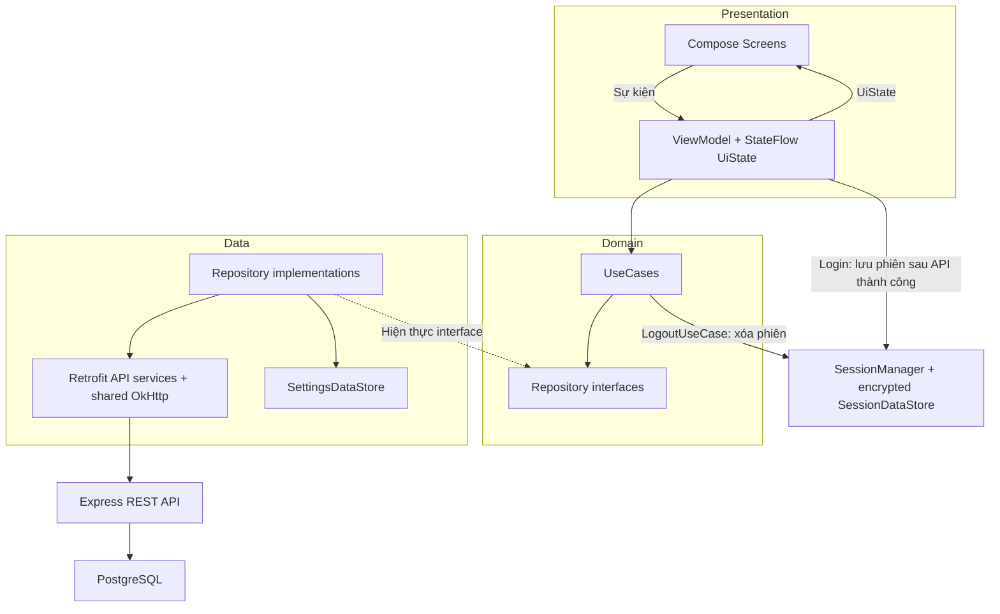
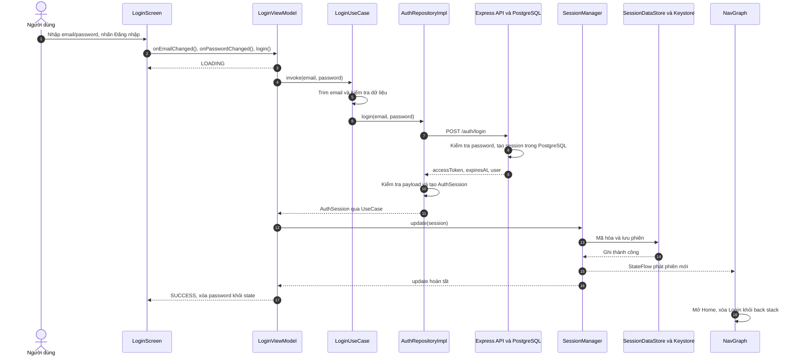
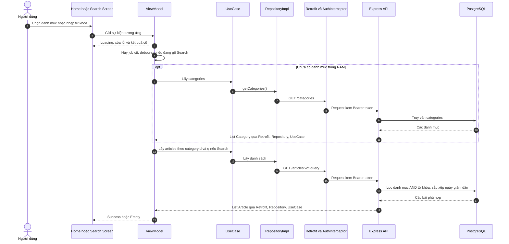
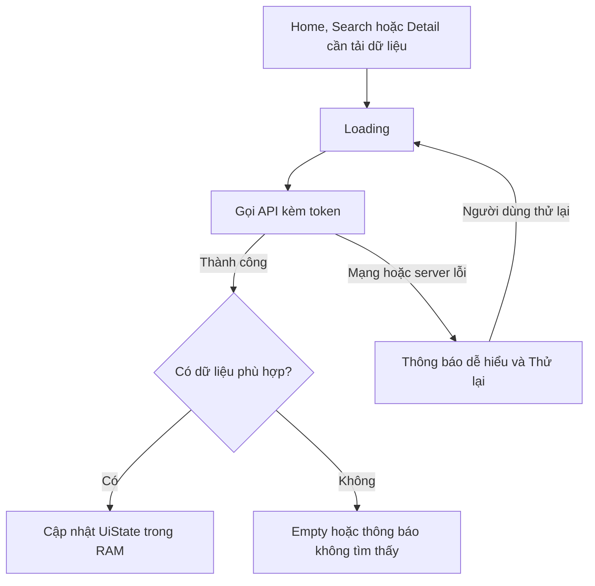
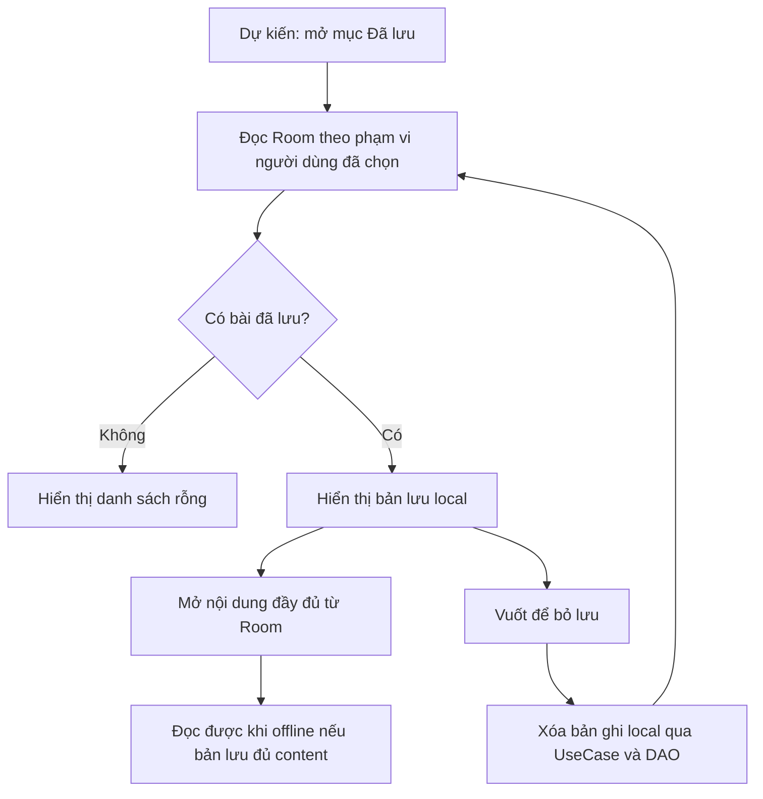
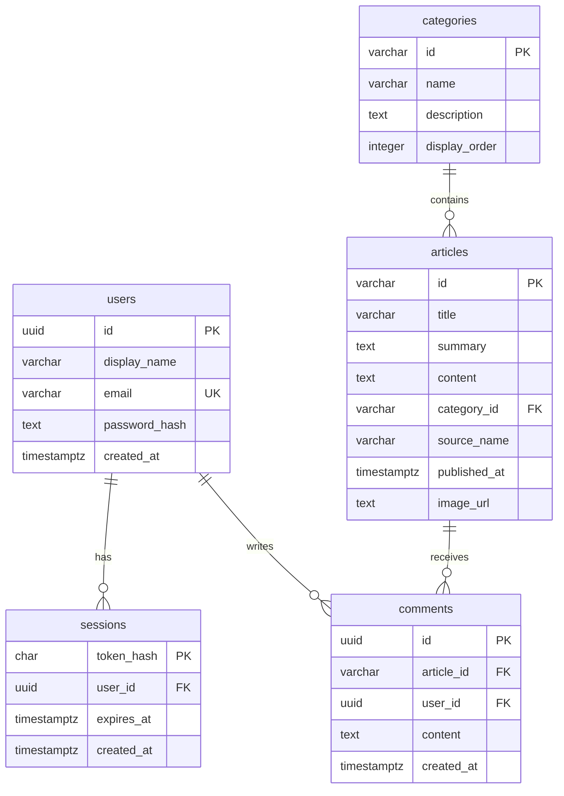

# App Architecture

> **NewsHub — A3: Architecture & Data Design**  
> Cập nhật theo source ngày **27/10/2026**. Package thực tế: `com.example.mobile`.
>
> Tài liệu bao quát phần việc của **Nhung và Thái** theo phân công đã xác nhận. **Đã triển khai** chỉ phần có logic trong source đang kiểm tra; **Dự kiến** mô tả cách ghép phần chức năng còn thiếu vào kiến trúc. Tên người phụ trách thể hiện phân công, không thay thế bằng chứng đóng góp hoặc kiểm thử.

Phạm vi ứng dụng gồm đăng nhập, đăng ký, xem tin theo danh mục, tìm kiếm, đọc chi tiết, bình luận, lưu bài để đọc offline, vuốt để bỏ lưu, hồ sơ, đổi giao diện và đăng xuất. Backend riêng dùng Node.js/Express và PostgreSQL; Android dùng Kotlin, Jetpack Compose và MVVM kết hợp UseCase/Repository.

| Chức năng | Phụ trách theo phân công | Trạng thái trong dự án hiện tại |
|---|---|---|
| Đăng nhập, khôi phục phiên | Nhung; phần xác thực dùng chung | Android và API đã có logic; phiên được lưu mã hóa. |
| Đăng ký | Thái | API đã có; `RegisterScreen`, `RegisterViewModel`, `RegisterUseCase` Android còn trống. |
| Home, danh mục, danh sách tin | Nhung | Đã gọi API, lọc danh mục và xử lý loading/success/empty/error. |
| Tìm kiếm kết hợp danh mục | Nhung | Đã gọi API; debounce 300 ms khi nhập từ khóa. |
| Nội dung chi tiết bài viết | Nhung | Đã gọi API chi tiết theo articleId. |
| Xem và gửi bình luận | Thái | Backend và model `Comment` đã có; Android chưa nối API/UI, `PostCommentUseCase` còn trống. |
| Bookmark, Room, đọc offline, vuốt để xóa | Thái | Đã có khung thư mục/file; logic, Room dependency, DAO và database chưa triển khai. |
| Hồ sơ, giao diện sáng/tối, đăng xuất | Nhung | Đã triển khai; Profile lấy User từ phiên local, theme lưu DataStore. |
| Network, thành phần UI, điều hướng | Cả hai | Hạ tầng đang dùng đã có; route Register/Saved chưa được đưa vào NavHost. |

---

## 1. Layers

### Kiến trúc đang sử dụng

NewsHub tổ chức theo tính năng, mỗi tính năng chia thành `presentation`, `domain`, `data`. Các phần dùng chung nằm trong `core`. Screen hiển thị UiState và phát callback; ViewModel xử lý sự kiện, gọi UseCase và cập nhật state. UseCase phụ thuộc interface Repository; lớp implementation quyết định cách lấy/ghi dữ liệu.



Mũi tên nét đứt thể hiện quan hệ hiện thực interface. Sơ đồ phản ánh source hiện tại: phiên đăng nhập được quản lý riêng qua `SessionManager`; chưa có luồng Room hoạt động.

| Layer | Our implementation (folders / main classes) | Owner (member) |
|-------|---------------------------------------------|----------------|
| Presentation | `feature/*/presentation`: `LoginScreen`, `HomeScreen`, `SearchScreen`, `ArticleDetailScreen`, `ProfileScreen`; ViewModel và UiState tương ứng. `navigation/NavGraph.kt` nối state/callback và điều hướng. UI dùng chung ở `core/ui/components`; theme đang dùng ở `ui/theme`. | Nhung: Login/Home/Search/nội dung Detail/Profile. Thái: Register/Saved/bình luận **dự kiến**. Navigation và UI chung: cả hai. |
| Domain | `feature/*/domain`: các interface `AuthRepository`, `HomeRepository`, `SearchRepository`, `ArticleRepository`, `SettingsRepository`; UseCase như `LoginUseCase`, `GetNewsUseCase`, `SearchArticlesUseCase`, `GetArticleDetailUseCase`, `UpdateThemeUseCase`, `LogoutUseCase`. | Nhung phụ trách các luồng hiện có; Thái phụ trách `RegisterUseCase`, `PostCommentUseCase`, nhóm Saved UseCase **chưa có logic**. |
| Data | `feature/*/data`: `AuthRepositoryImpl`, `HomeRepositoryImpl`, `SearchRepositoryImpl`, `ArticleRepositoryImpl`, `SettingsRepositoryImpl`, Retrofit services/DTO. `core/network`, `core/datastore`, `core/session`, `core/model` phục vụ dùng chung. `core/database` và Saved data mới là khung. | Network/xác thực: cả hai. Settings và model chung: Nhung. Room/DAO/Saved: Thái, **dự kiến**. |

`MainActivity` là nơi lắp ghép dependency: tạo service từ `RetrofitClient.retrofit`, đưa vào RepositoryImpl, UseCase rồi ViewModel factory. Đây là **manual dependency injection**, chưa dùng Hilt/Koin. Một Retrofit/OkHttp dùng chung cấu hình connect 15 giây, read 30 giây, write 15 giây; `AuthInterceptor` lấy token từ RAM theo từng request. Chi tiết tại [API Integration](api-integration.md).

Backend là ứng dụng độc lập trong `backend/`. Express có route, middleware xác thực/kiểm tra dữ liệu, auth service, article repository và truy vấn PostgreSQL dùng tham số. Một số route như categories/comments truy vấn qua pool ngay trong handler; tài liệu không giả định backend đã chia ba tầng đồng nhất cho mọi tài nguyên.

**Giới hạn hiện tại:** đây là phân lớp trong **một module Gradle `:app`**, chưa phải nhiều module độc lập hay Clean Architecture thuần. `LoginUseCase` còn dùng `android.util.Patterns`; `LogoutUseCase` gọi singleton `SessionManager`; Search dùng `NewsApiService` đặt trong Home data. Interface Repository vẫn giúp tách lời gọi từ UseCase khỏi lớp Retrofit cụ thể.

### Ghép các chức năng của Thái vào kiến trúc — dự kiến

| Chức năng | Luồng dự kiến | Điểm đã có để kết nối |
|---|---|---|
| Đăng ký | RegisterScreen → RegisterViewModel → RegisterUseCase → AuthRepository → AuthRepositoryImpl → AuthApiService | Backend `POST /auth/register` đã nhận `displayName`, `email`, `password`, trả `201` và thông báo; không tự cấp phiên. Cần bổ sung method/DTO Android, state và route; đăng ký thành công quay về Login. |
| Bình luận | Article Detail UI → ViewModel → UseCase lấy/gửi bình luận → ArticleRepository → ArticleApiService | Model `Comment`, backend GET/POST `/articles/:articleId/comments` đã có. Cần bổ sung method service/repository, UseCase lấy danh sách và state bình luận; tên lớp mới chưa được chốt trong source. |
| Lưu và bỏ lưu bài | Detail/Saved UI → ViewModel → Save/GetSaved/RemoveSaved UseCase → SavedRepositoryImpl → SavedArticleDao → NewsHubDatabase | Các file Saved/DAO/database đã tạo nhưng trống. Cần bổ sung contract Repository, Room dependency/processor và mapping Entity/Article. |

Bình luận cần state tải danh sách và state gửi riêng, để lỗi gửi không che mất nội dung bài. Backend lấy tác giả từ phiên Bearer đã xác thực; client chỉ gửi nội dung bình luận, không tự quyết định `userId`. Saved được thiết kế là dữ liệu local; backend hiện không có endpoint bookmark.

---

## 2. State Management

**Our choice:** Android ViewModel + `StateFlow`, Kotlin Coroutines và Compose `collectAsStateWithLifecycle()`.

**Why:** ViewModel giữ trạng thái khi giao diện được tạo lại do thay đổi cấu hình; coroutine xử lý tác vụ bất đồng bộ và hủy theo vòng đời ViewModel. StateFlow cung cấp giá trị mới nhất để UI quan sát. Screen nhận state chỉ đọc và callback, thuận tiện kiểm tra logic riêng với UI. UiState trong RAM **không** thay thế lưu trữ bền vững: phiên và theme cần DataStore để tồn tại sau khi tiến trình bị tắt.

So với giữ toàn bộ logic bằng `remember` trong Screen, lựa chọn này tập trung xử lý dữ liệu ở ViewModel. Hiện chưa cần một Redux/MVI framework riêng hoặc state chung cho mọi màn; mỗi tính năng có state riêng, còn phiên/theme được chia sẻ có chủ đích.

### Cách mô hình hóa state thực tế

App dùng `data class` và enum cho Login; chưa dùng một sealed class Loading/Success/Empty/Error chung cho toàn bộ ứng dụng.

| Màn / phạm vi | State thực tế | Cách UI diễn giải |
|---|---|---|
| Login | `AuthUiState(email, password, status, validationMessage, errorMessage, isLoggedIn)`; `LoginStatus = FORM / LOADING / SUCCESS / ERROR` | Lỗi nhập liệu ở FORM; đang gửi khóa thao tác; lỗi API hiển thị thông báo; lưu phiên thành công dẫn đến Home. |
| Home | `HomeUiState(isLoading, categories, articles, selectedCategoryId, errorMessage)`; `isEmpty` là thuộc tính tính toán | Ưu tiên loading → error → empty → danh sách thành công. |
| Search | `SearchUiState` chứa query, category đã chọn, categories, articles, loading và error | Có cùng bốn trạng thái dữ liệu; kết quả phụ thuộc đồng thời từ khóa và danh mục. |
| Article Detail | `ArticleDetailUiState(isLoading, article, errorMessage)` | Loading, lỗi/retry hoặc nội dung bài; `404` được biểu diễn bằng thông báo lỗi phù hợp. |
| Profile | `ProfileUiState(user, isLoggingOut, isUpdatingTheme, errorMessage)` | Hai cờ bận để chặn thao tác trùng; User là bản lấy từ phiên khi tạo ViewModel. |
| Phiên toàn app | `SessionManager.session: StateFlow<AuthSession?>` | Có phiên còn hạn thì dùng màn được bảo vệ; không có thì Login. |
| Giao diện toàn app | `SettingsRepository.isDarkTheme: Flow<Boolean>` | MainActivity quan sát và truyền vào `MobileTheme`; Profile nhận cùng giá trị này. |

Một ví dụ diễn giải Home:

```text
Loading = isLoading
Error   = !isLoading && errorMessage != null
Empty   = !isLoading && errorMessage == null && articles.isEmpty()
Success = !isLoading && errorMessage == null && articles.isNotEmpty()
```

Home hủy job trước khi đổi danh mục. Search hủy job cũ, đợi 300 ms khi gõ từ khóa, rồi gửi truy vấn mới; chọn danh mục hoặc nhấn tìm kiếm thì không đợi debounce. `CancellationException` được ném lại, không chuyển thành lỗi hiển thị. Khi tải mới, danh sách kết quả cũ bị xóa; đây chưa phải chiến lược giữ cache cũ trong lúc refresh.

`LoadingSkeleton` và `ErrorState` dùng chung giúp các màn hiển thị nhất quán. Home/Search/Detail có callback thử lại. Login retry chỉ đưa về form và người dùng nhập lại password; không tự lặp request. Lỗi HTTP/mạng được đổi sang thông báo tiếng Việt, không hiển thị stack trace.

**Phần của Thái dự kiến:** Register cần state form/loading/success/error; Saved cần loading/list/empty/error cùng trạng thái lưu/xóa; Detail bổ sung `comments`, trạng thái tải, nội dung đang nhập và trạng thái gửi bình luận. Những field này là thiết kế cần làm, chưa tồn tại trong UiState hiện tại.

---

## 3. Data Flow

### 3.1. Đăng nhập → lưu phiên → Home — đã triển khai



Sơ đồ thể hiện nhánh thành công. Nếu validation thất bại, không gọi API; nếu API hoặc lưu phiên lỗi, LoginViewModel cập nhật thông báo. SessionManager **ghi DataStore trước, cập nhật RAM sau**; ứng dụng không công bố phiên mới khi ghi local chưa thành công. NavGraph quan sát phiên nên có thể chuyển Home ngay, thẻ SUCCESS ở Login có thể chỉ xuất hiện rất ngắn.

Khi mở app, `MainActivity` chờ `SessionManager.restore()` và đọc theme ban đầu trước `setContent`. Phiên hợp lệ theo dữ liệu local dẫn tới Home, ngược lại Login. Startup chưa gọi `/auth/me` để xác minh lại server. NavGraph so sánh hạn phiên khi composition chạy; chưa có timer tự kích hoạt đúng thời điểm hết hạn. Response `401` ở Home/Search/Detail hiện chỉ báo lỗi, chưa tự xóa phiên toàn app.

### 3.2. Home/Search → API → danh sách — đã triển khai



Khi request lỗi, ViewModel phát Error với callback thử lại. Hiện không có bước ghi danh sách API vào Room. Nhấn ArticleCard truyền ID qua `Routes.articleDetail(id)`; Detail dùng ID gọi `GET /articles/{articleId}`, không truyền toàn bộ Article trong route. Backend có `limit`/`offset`, nhưng Android chưa tích hợp phân trang.

### 3.3. Đổi giao diện và đăng xuất — đã triển khai

Đổi theme: ProfileScreen → ProfileViewModel → UpdateThemeUseCase → SettingsRepositoryImpl → SettingsDataStore. DataStore phát Boolean mới; MainActivity quan sát rồi dựng lại theme của toàn app. Theme có hai lựa chọn **Sáng/Tối**, mặc định Sáng, chưa có chế độ Theo hệ thống. Lưu theme không cần backend.

Đăng xuất: ProfileViewModel → LogoutUseCase → AuthRepositoryImpl → `POST /auth/logout`. Thành công hoặc server trả `401` thì cho phép `SessionManager.clear()`; NavGraph nhận phiên null, xóa các back stack được bảo vệ và quay Login. Nếu mất mạng hoặc lỗi server, luồng hiện tại báo lỗi và **giữ phiên**, không giả định logout offline thành công. Theme không bị xóa khi đăng xuất.

### 3.4. Lưu bài và bình luận — thiết kế cho phần của Thái

Lưu bài dự kiến: người dùng nhấn bookmark → UseCase kiểm tra bài có nội dung đầy đủ → Repository chuyển sang SavedArticleEntity → DAO ghi Room → Flow danh sách bài đã lưu cập nhật SavedScreen. Mở bài đã lưu đọc từ Room; vuốt xóa gọi RemoveSavedArticleUseCase và chỉ xóa bản lưu local.

Bình luận dự kiến: Detail tải danh sách qua GET comments; người dùng gửi nội dung → UseCase kiểm tra → Repository gọi POST comments → server kiểm tra phiên, lưu PostgreSQL → UI cập nhật danh sách sau thành công. Khi lỗi, giữ nội dung đang soạn để người dùng thử lại. Chưa thiết kế hàng đợi gửi bình luận offline hoặc đồng bộ nền.

---

## 4. Offline Strategy

### Dữ liệu đã có trong source

| Data | Stored where | Read policy | Write policy | Conflict handling |
|------|--------------|-------------|--------------|-------------------|
| Phiên `AuthSession` | Preferences DataStore, file `noBackupFilesDir/newshub_session.preferences_pb`; RAM trong SessionManager | Restore trước khi tạo UI; kiểm tra dữ liệu và hạn phiên local; file/phiên không hợp lệ trở về không có phiên | Login ghi phiên mã hóa trước khi phát StateFlow; logout xóa khóa phiên sau khi API cho phép | Mutex tuần tự hóa restore/update/clear trong tiến trình. Server quyết định tính hợp lệ của token khi gọi API; chưa có đồng bộ tự động local với server khi nhận 401 ở màn dữ liệu. |
| Cài đặt sáng/tối | Preferences DataStore, `filesDir/datastore/newshub_settings.preferences_pb`, khóa Boolean `dark_theme` | Đọc lần đầu trước UI, sau đó quan sát Flow; nếu chưa lưu giá trị thì dùng false/Sáng | Ghi bằng DataStore edit; dùng ngay cho toàn app, không cần mạng | Cài đặt theo thiết bị; giá trị của lần ghi thành công sau cùng được lưu. Không đồng bộ lên tài khoản/server. |
| Danh mục, kết quả Home/Search, nội dung Detail | UiState trong RAM; dữ liệu gốc ở PostgreSQL backend | API khi ViewModel cần tải; categories được dùng lại nếu danh sách RAM còn dữ liệu | API trả về cập nhật UiState; không ghi cache bền vững | Server là nguồn dữ liệu cho nội dung; request cũ bị hủy khi thay bộ lọc. RAM có thể mất khi tiến trình bị dừng. |
| Hồ sơ hiển thị | User nằm trong phiên đã lưu | Profile lấy bản User từ SessionManager lúc tạo ViewModel | Nhận lại cùng phiên khi đăng nhập | Chưa gọi GET `/auth/me`; hồ sơ local chưa tự làm mới nếu server thay đổi. |

Luồng dữ liệu nội dung hiện tại:



`SessionDataStore` giúp nhớ đăng nhập và `SettingsDataStore` giúp nhớ giao diện, **chưa tạo khả năng đọc tin offline**. Retrofit/OkHttp chưa cấu hình disk cache; backend đặt `Cache-Control: no-store`. Nội dung còn trong RAM có thể vẫn đang hiển thị, nhưng không phải bằng chứng bài được lưu bền vững để đọc sau khi tắt app.

### Saved/Room — chiến lược dự kiến cho Thái

Room là thư viện Android làm việc với SQLite trong ứng dụng. PostgreSQL nằm ở backend; không phải database cài thêm vào điện thoại để Room sử dụng. Hai nơi lưu trữ có trách nhiệm khác nhau.

| Data | Stored where | Read policy | Write policy | Conflict handling |
|------|--------------|-------------|--------------|-------------------|
| Bài được người dùng chủ động lưu | **Dự kiến:** Room qua NewsHubDatabase/SavedArticleDao | SavedScreen quan sát Flow từ DAO; mở bài đã lưu đọc local, không bắt buộc gọi mạng | Chỉ ghi khi người dùng nhấn Lưu; lưu cả content, không chỉ dữ liệu tóm tắt từ Home/Search | Đề xuất giữ bản snapshot lúc lưu; nếu lưu lại cùng bài thì cập nhật bản local, tránh bản ghi trùng. Chưa có đồng bộ bookmark nhiều thiết bị. |
| Trạng thái bookmark | **Dự kiến:** suy ra từ bản ghi Room | Kiểm tra articleId trong tập bài đã lưu để hiển thị nút Lưu/Bỏ lưu | Bookmark thêm/cập nhật bản ghi; bỏ lưu hoặc vuốt xóa bản ghi local | Không xóa bài gốc PostgreSQL. Nếu cần tách theo tài khoản, đề xuất khóa `(userId, articleId)` và chỉ truy vấn user hiện tại; chính sách này cần được triển khai trước khi khẳng định hỗ trợ nhiều tài khoản. |
| Bình luận và đăng ký khi offline | PostgreSQL qua API; Android chưa có queue local | Không tải mới/gửi mới khi không truy cập được server | Thông báo lỗi và cho thử lại khi có kết nối | Không tự gửi lặp hoặc giả định đã thành công; chưa có giải pháp xung đột đồng bộ vì chưa có offline write. |



Các file Room/Saved hiện còn trống, Gradle chưa khai báo Room. Cần hoàn thành entity, DAO, database, repository contract/implementation, UseCase, ViewModel, UI và route Saved; luồng mở chi tiết cũng cần thêm đường đọc local. Profile chưa có bộ đếm bài đã lưu thực tế. Chính sách giữ/xóa bản lưu khi logout và việc phân vùng theo user phải được thống nhất khi triển khai; source hiện chưa có hành vi đó.

### Bảo vệ dữ liệu nhạy cảm

Toàn bộ JSON AuthSession được mã hóa **AES-256-GCM** trước khi ghi DataStore; khóa do **Android Keystore** quản lý, alias `newshub.session.aes`. File chứa dữ liệu mã hóa nằm trong `noBackupFilesDir`. Password không được lưu vào phiên; Login xóa password khỏi UiState sau thành công/lỗi API. DataStore tự nó không phải cơ chế mã hóa: bảo vệ phiên đến từ lớp mã hóa trong `SessionDataStore`.

Server lưu password bằng scrypt có salt và chỉ lưu SHA-256 digest của token ngẫu nhiên; token là opaque token, không phải JWT, chưa có refresh token. Mã hóa local không bảo vệ dữ liệu trên đường truyền: app đang gọi HTTP trong môi trường phát triển và main Manifest cho phép cleartext; HTTPS/cấu hình production chưa triển khai.

Source tham chiếu: [SessionDataStore.kt](../app/src/main/java/com/example/mobile/core/datastore/SessionDataStore.kt), [SessionManager.kt](../app/src/main/java/com/example/mobile/core/session/SessionManager.kt), [SettingsDataStore.kt](../app/src/main/java/com/example/mobile/core/datastore/SettingsDataStore.kt), [passwords.mjs](../backend/src/auth/passwords.mjs), [auth/service.mjs](../backend/src/auth/service.mjs).

---

## 5. Project Structure

Cấu trúc thực tế rút gọn dưới đây bỏ qua thư mục build, cache và node_modules. Ký hiệu **[khung]** chỉ file/thư mục đã có nhưng chưa có logic chức năng; phần không đánh dấu cũng không mặc nhiên có nghĩa mọi yêu cầu tương lai đã hoàn thành.

```text
GreetingCard/
├── app/                                      # Module Android :app
│   ├── build.gradle.kts                      # Compose, lifecycle, DataStore, Retrofit; chưa có Room
│   └── src/
│       ├── main/
│       │   ├── AndroidManifest.xml
│       │   ├── java/com/example/mobile/
│       │   │   ├── MainActivity.kt           # Lắp dependency, restore phiên/theme, tạo UI
│       │   │   ├── NewsHubApplication.kt     # [khung]
│       │   │   ├── core/
│       │   │   │   ├── network/
│       │   │   │   │   ├── ApiConfig.kt
│       │   │   │   │   ├── RetrofitClient.kt
│       │   │   │   │   ├── AuthInterceptor.kt
│       │   │   │   │   └── ApiResult.kt       # [khung], chưa dùng để bọc response
│       │   │   │   ├── session/SessionManager.kt
│       │   │   │   ├── datastore/
│       │   │   │   │   ├── SessionDataStore.kt
│       │   │   │   │   └── SettingsDataStore.kt
│       │   │   │   ├── database/             # [khung] cho phần của Thái
│       │   │   │   │   ├── NewsHubDatabase.kt
│       │   │   │   │   └── dao/SavedArticleDao.kt
│       │   │   │   ├── model/                # Article, Category, User, AuthSession, Comment
│       │   │   │   ├── ui/
│       │   │   │   │   ├── components/       # Header, BottomBar, ArticleCard, Skeleton, ErrorState
│       │   │   │   │   └── theme/            # [khung], theme đang dùng nằm ở ui/theme bên dưới
│       │   │   │   └── util/Constants.kt     # [khung]
│       │   │   ├── feature/
│       │   │   │   ├── auth/
│       │   │   │   │   ├── presentation/     # LoginScreen/ViewModel/AuthUiState; Register [khung]
│       │   │   │   │   ├── domain/           # AuthRepository, Login/LogoutUseCase, AuthException
│       │   │   │   │   │                     # RegisterUseCase [khung]
│       │   │   │   │   └── data/             # AuthRepositoryImpl, AuthApiService, dto; FakeAuthRepository
│       │   │   │   ├── home/
│       │   │   │   │   ├── presentation/     # HomeScreen, HomeViewModel, HomeUiState
│       │   │   │   │   ├── domain/           # HomeRepository, GetNews/GetCategoriesUseCase
│       │   │   │   │   └── data/             # HomeRepositoryImpl, NewsApiService
│       │   │   │   ├── search/
│       │   │   │   │   ├── presentation/     # SearchScreen, SearchViewModel, SearchUiState
│       │   │   │   │   ├── domain/           # SearchRepository, SearchArticles/GetSearchCategoriesUseCase
│       │   │   │   │   └── data/             # SearchRepositoryImpl dùng NewsApiService
│       │   │   │   ├── article/
│       │   │   │   │   ├── presentation/     # ArticleDetailScreen/ViewModel/UiState
│       │   │   │   │   ├── domain/           # ArticleRepository, GetArticleDetailUseCase
│       │   │   │   │   │                     # PostCommentUseCase [khung]
│       │   │   │   │   └── data/             # ArticleRepositoryImpl, ArticleApiService
│       │   │   │   ├── saved/               # [khung] phần việc Thái
│       │   │   │   │   ├── presentation/     # SavedScreen, SavedViewModel, SavedUiState
│       │   │   │   │   ├── domain/           # Save/GetSavedArticles/RemoveSavedArticleUseCase
│       │   │   │   │   └── data/             # SavedRepositoryImpl, SavedArticleEntity
│       │   │   │   └── profile/
│       │   │   │       ├── presentation/     # ProfileScreen, ProfileViewModel, ProfileUiState
│       │   │   │       ├── domain/           # SettingsRepository, UpdateThemeUseCase
│       │   │   │       └── data/             # SettingsRepositoryImpl
│       │   │   ├── navigation/              # Routes.kt, NavGraph.kt
│       │   │   └── ui/theme/                # Color.kt, Theme.kt, Type.kt đang được sử dụng
│       │   └── res/                         # Tài nguyên Android
│       ├── test/                            # Unit test source
│       └── androidTest/                     # Instrumented test source
├── backend/
│   ├── src/
│   │   ├── server.mjs                       # Khởi động, migration/seed, lắng nghe HTTP
│   │   ├── app.mjs                          # Middleware và đăng ký route
│   │   ├── config.mjs
│   │   ├── auth/                           # routes, service, passwords
│   │   ├── articles/                       # routes, repository
│   │   ├── categories/                     # routes
│   │   ├── comments/                       # routes
│   │   ├── database/                       # pool, migrate, seed
│   │   └── middleware/                     # authenticate, errors
│   ├── migrations/001_initial.sql
│   ├── seeds/                              # Dữ liệu demo
│   ├── tests/                              # API và password tests
│   ├── Dockerfile
│   ├── package.json
│   └── README.md
├── docs/                                   # Architecture, API, hướng dẫn, kiểm thử, AI log
├── scripts/                                # Tạo env, quản lý DB native, demo API
├── docker-compose.yml                      # API, PostgreSQL và profile test
└── settings.gradle.kts                      # Khai báo module :app
```

`FakeAuthRepository` còn trong source nhưng factory hiện tại chọn `AuthRepositoryImpl` gọi backend. Có tên route Register/Saved trong `Routes` chưa đủ để coi đã có màn hoạt động: NavHost mới nối Login/Home/Search/Profile/Article Detail, nút Saved hiện bị vô hiệu hóa.

### Mô hình dữ liệu server thực tế



Đây là năm bảng nghiệp vụ theo [001_initial.sql](../backend/migrations/001_initial.sql); `schema_migrations` là bảng kỹ thuật theo dõi migration. PostgreSQL chưa có bảng bookmark hoặc theme. REST trả JSON camelCase phù hợp Kotlin; các truy vấn server ánh xạ cột snake_case sang tên trường JSON. Model `Article` dùng chung cho list/detail: content nullable vì list không trả content; `Comment` có model nhưng Android chưa dùng để gọi API.

Docker Compose mô tả API container cổng 8000 và PostgreSQL container cổng 5432, host DB mặc định 5433; API kết nối database bằng hostname `db`. Dữ liệu PostgreSQL dùng named volume `postgres_data`. Có script chạy native Windows riêng. Đây là mô tả cấu hình, không phải xác nhận đã chạy Docker thành công trong lượt cập nhật tài liệu này.

---

## 6. Design Decisions

Bảng ghi quyết định thể hiện trong source hoặc đề xuất cho phần chưa làm. Cột alternatives dùng để giải thích lựa chọn, không khẳng định nhóm đã triển khai và thử nghiệm mọi phương án đó.

| Decision | Alternatives considered | Why we chose this |
|----------|------------------------|-------------------|
| **Đã dùng:** Kotlin + Jetpack Compose | XML Views | UI được mô tả theo state, dễ dùng chung Header/Card/ErrorState và áp dụng theme cho toàn app. |
| **Đã dùng:** chia theo feature, mỗi feature có presentation/domain/data | Gom toàn bộ Screen/ViewModel/Repository vào các thư mục lớn theo loại | Nhung/Thái có phạm vi chức năng rõ; đọc luồng của một tính năng trong cùng nhánh, `core` chứa phần dùng chung. Hiện vẫn là một module Gradle. |
| **Đã dùng:** MVVM + StateFlow + Coroutines | Giữ logic trong Composable; state framework riêng | Tách render khỏi logic và tác vụ mạng; state chỉ đọc, hủy tác vụ theo vòng đời, đủ gọn cho quy mô ứng dụng. |
| **Đã dùng:** UseCase và interface Repository | ViewModel gọi Retrofit trực tiếp | Đặt validation/quy tắc ở UseCase; ViewModel phụ thuộc contract; implementation chịu trách nhiệm nguồn dữ liệu. Chấp nhận thêm vài lớp và các giới hạn phân lớp nêu ở mục 1. |
| **Đã dùng:** manual DI qua factory trong MainActivity | Hilt/Koin | Dependency hiện còn ít, có thể thấy rõ cách lắp từng luồng. Khi số feature tăng, MainActivity có thể dài và cần nơi lắp ghép riêng. |
| **Đã dùng:** Retrofit/Gson và một OkHttp có AuthInterceptor | Mỗi Screen tạo HTTP request/client riêng | Tập trung chuyển đổi JSON, gắn Bearer token, timeout và dùng chung cấu hình kết nối. Chưa có bộ xử lý 401 toàn cục hay refresh token. |
| **Đã dùng:** session DataStore có AES-GCM/Keystore | Chỉ giữ RAM; lưu token plaintext; Room cho phiên | RAM không giữ được sau khi tắt tiến trình; phiên nhỏ phù hợp key-value. Mã hóa bổ sung bảo vệ token lưu trên thiết bị, không lưu password. |
| **Đã dùng:** DataStore Boolean cho theme | Chỉ nhớ trong ViewModel; gọi backend lưu theme | Sáng/Tối là thiết lập nhỏ, dùng offline và tồn tại sau khi mở lại. Chưa có lựa chọn Theo hệ thống hoặc đồng bộ nhiều thiết bị. |
| **Đã dùng:** điều hướng tập trung trong Routes/NavGraph | Tự chuyển màn rải rác trong Screen | Screen phát callback; NavGraph quản lý route, ID bài viết, tab và back stack. Login bị xóa sau đăng nhập, các màn bảo vệ bị dọn sau logout. |
| **Đã dùng:** backend Express + PostgreSQL độc lập | JSON Server/db.json; app kết nối PostgreSQL trực tiếp | Có xác thực, kiểm tra dữ liệu và lưu quan hệ User/Session/Article/Comment phía server; Android chỉ làm việc qua REST. |
| **Đã dùng:** token ngẫu nhiên có bản digest phía server | JWT stateless | Xóa session làm token hiện tại mất hiệu lực phía server; đổi lại mỗi request bảo vệ cần tra database. Không có refresh token. |
| **Đã dùng:** migration có version và seed có thể chạy lại | Tạo bảng thủ công; reset database mỗi lần chạy | Cấu trúc được theo dõi trong schema_migrations; seed dùng ON CONFLICT DO NOTHING, giữ dữ liệu đã có thay vì ghi đè tài khoản/bình luận. |
| **Đã dùng:** Compose file cho API và DB riêng; có script native | Đặt backend lẫn Android; mỗi người tự tạo DB thủ công | Tách trách nhiệm và có cấu hình môi trường có thể chia sẻ. Không suy ra runtime Docker đã được kiểm thử chỉ từ việc có file Compose. |
| **Dự kiến — Thái:** Room cho bài được chủ động lưu | DataStore chứa cả danh sách bài; chỉ giữ nội dung trên server | Bài có nhiều field và cần truy vấn/xóa/quan sát danh sách; Room phù hợp hơn key-value. Lưu đủ content mới đọc offline được. Chưa có implementation hiện tại. |
| **Dự kiến — Thái:** bình luận online, không có queue offline | Optimistic update và hàng đợi đồng bộ nền | Giữ luồng học tập đơn giản, tránh khẳng định bình luận đã lưu khi server chưa nhận. Cần state gửi và retry riêng khi tích hợp Android. |

### Các điểm cần hoàn thành trước khi khẳng định đầy đủ phạm vi đề tài

1. Tích hợp Android Register và API bình luận; bổ sung validation, state, retry và route phù hợp.
2. Triển khai Room/Saved, lưu đầy đủ nội dung, mở local khi offline, vuốt bỏ lưu; thống nhất phạm vi theo tài khoản và chính sách logout.
3. Nối route Saved, bật tab và bổ sung thống kê bài đã lưu trên Profile nếu vẫn thuộc yêu cầu UI.
4. Đưa base URL ra cấu hình môi trường/build: hiện `ApiConfig.BASE_URL` vẫn là chuỗi cố định `http://10.0.2.2:8000/` trong source.
5. Hoàn thiện xử lý phiên bị server từ chối hoặc hết hạn khi app đang mở; hiện chưa có xử lý 401 tập trung/timer hết hạn. Tách cấu hình HTTP phát triển và HTTPS khi triển khai thực tế.

Tài liệu liên quan: [API Integration](api-integration.md), [API contract](api-contract.md), [hướng dẫn kiểm thử và bằng chứng đã ghi](testing-guide.md). Trạng thái “đã triển khai” trong tài liệu này được đối chiếu source; không đồng nghĩa lượt viết tài liệu đã chạy lại build, emulator, Docker hoặc toàn bộ kiểm thử.
